# 架构说明：需求、模块、组件与开发流程

> 本文件由原《需求文档》《模块划分与数据流》《组件工作机制》《开发流程》于 2026-11-06 归并而成。
> 产品名「招标文件多智能体系统」与实现形态（多角色 LLM 工作流，非自主多 Agent）的术语界定见根目录 `../AGENTS.md` 第 1 节。

## 目录

- 第一部分　需求与业务边界（原《需求文档》）
- 第二部分　模块划分与数据流（原《模块划分与数据流》）
- 第三部分　组件工作机制（原《组件工作机制》）
- 第四部分　开发流程与验证门禁（原《开发流程》）

## 第一部分　需求与业务边界（原《需求文档》）

> 文档版本：1.1  
> 阶段：方案设计（本阶段不产出代码）  
> 配套文档：`tech-decisions.md`（选型与取舍）、`architecture.md`（模块与数据流）、`tech-decisions.md`（分工与架构决策）、`api-contract.md`（业务/接口/数据规范）。

---

### 1. 文档说明

#### 1.1 目的

本文档回答「**做什么、为什么做、做到什么程度算合格**」，用于：

- 对齐产品目标与业务边界；
- 作为技术选型、模块划分、团队分工的输入；
- 作为验收与评审的依据。

#### 1.2 范围与边界

- 本文只描述**需求与业务**，不讨论技术实现、选型与算法（见配套文档）；
- 涉及实现细节时，以 `api-contract.md`、`tech-decisions.md`、`algorithms.md` 为准；
- 不包含真实密钥、账号、内网地址等敏感信息。

#### 1.3 运行形态（桌面端 + Web 端，均为必选）

系统采用同一套前端，支持两种运行形态，二者均为本期交付形态：

| 形态 | 说明 | 独有能力 |
|---|---|---|
| Electron 桌面端 | 桌面应用加载同一套前端 | 打开本地 Word、定位产物目录（经 IPC 白名单） |
| PC 浏览器 Web 端 | 前后端分离，浏览器访问 | 无桌面能力，以预览/下载替代打开/定位 |

两形态共享同一后端接口与 Agent 业务逻辑，仅前端运行载体与桌面能力不同。

---

### 2. 项目背景与问题

投标工作通常需要反复阅读几十到几百页招标文件，提取资格条件、评分办法、投标文件格式、合同条款与采购需求，再组织成一份逐项响应的投标文件。人工处理存在以下痛点：

| 痛点 | 说明 |
|---|---|
| 篇幅长、章节多 | 关键要求容易遗漏 |
| 评分因素与格式条目需逐条对应 | 检查成本高 |
| 初稿重复劳动多 | 公司资料、业绩、人员反复填写 |
| 缺少覆盖度自检 | 难以判断哪些评分项没有响应 |

本系统把上述过程拆分为可追踪的异步任务：先解析并结构化招标文件，再基于抽取结果组织多角色编写，最后输出带覆盖报告和占位符清单的投标文件草稿。

---

### 3. 目标与成功标准

#### 3.1 产品目标

| 目标 | 含义 |
|---|---|
| 可追溯 | 每个解析/抽取/编写任务有唯一标识、状态、进度与产物目录 |
| 可复用 | 同一份招标文件只解析一次，后续编写复用已有结果 |
| 可检查 | 输出格式覆盖、评分因素三层覆盖（计划/正文/证据）、章节得分、缺失资料与未覆盖因素 |
| 不编造 | 资料缺失时生成统一占位符，不虚构公司、人员、业绩、财务或报价 |
| 可交付 | 同时产出可编辑 Markdown、Word 草稿与结构化报告 |

#### 3.2 成功标准（可衡量）

| 指标 | 目标 |
|---|---|
| 单文档解析 | 200 页级 PDF 自动分片解析，云端失败可回退本地 |
| 抽取完整性 | 评分因素、资格条件、投标格式条目结构化落盘并溯源核对 |
| 编写产物 | 生成 `bid.md` / `bid.docx` / `report.json` 三类产物 |
| 覆盖自检 | 报告给出格式覆盖数、评分因素三层覆盖（计划/正文/证据）数与逐层缺口、未覆盖因素、缺失资料 |
| 合规性 | 报价、清单、缺失资料只生成占位符，不自动填写、不编造 |
| 使用形态 | 同一套前端，桌面端（Electron）与 Web 端（浏览器）两种形态均为必选交付 |

---

### 4. 用户与使用场景

#### 4.1 目标用户

| 角色 | 说明 |
|---|---|
| 投标文员/商务人员 | 主要用户，上传招标文件、填写公司资料、生成初稿 |
| 技术负责人/评审人员 | 查看覆盖报告、核对占位符与缺失资料 |
| 开发者/运维 | 通过 CLI 与健康检查排障、批处理 |

#### 4.2 核心使用场景

| 场景 | 触发 | 期望结果 |
|---|---|---|
| 文档接入 | 上传招标 PDF | 异步解析，返回任务进度与解析摘要 |
| 结构化抽取 | 解析时勾选抽取 | 产出评分办法、资格条件、格式条目等结构化结果 |
| 建立检索索引 | 解析时勾选入库 | 章节感知分块并写入向量库，供编写引用 |
| 投标编写 | 选择已抽取文档 + 填写资料 | 多角色生成草稿与覆盖报告 |
| 产物交付 | 编写完成 | 预览/下载 Markdown、Word、报告；桌面端另可打开文件/定位目录，Web 端以下载交付 |
| 历史回顾 | 查看历史产物 | 列出历史投标结果与覆盖摘要 |
| 排障 | 环境异常 | CLI `doctor`、健康检查给出定位信息 |

---

### 5. 功能需求

> 编号规则：`FR-模块-序号`。验收要点仅列「可验证」的关键项，细节见 `api-contract.md`。

#### 5.1 上传解析（FR-UPLOAD）

| 编号 | 需求 | 验收要点 |
|---|---|---|
| FR-UPLOAD-01 | 拖拽/选择 PDF 上传 | 校验扩展名、非空、PDF 文件头、大小上限 |
| FR-UPLOAD-02 | 选择解析方式：自动/云端/本地 | 云端失败可按配置回退本地并记录原因 |
| FR-UPLOAD-03 | 可选：结构化抽取 | 未抽取时禁止发起编写，并提示原因 |
| FR-UPLOAD-04 | 可选：建立检索索引（向量入库） | 入库成功返回新增/更新/删除/未变片段数 |
| FR-UPLOAD-05 | 可选：强制重解析 | 忽略缓存重新解析，避免「以为走云端实际复用本地」 |
| FR-UPLOAD-06 | 异步任务 + 进度轮询 | 202 返回 job_id，前端按状态展示阶段日志 |

#### 5.2 文档库（FR-LIB）

| 编号 | 需求 | 验收要点 |
|---|---|---|
| FR-LIB-01 | 列出已解析文档 | 显示 doc_id、文件名、类型、页数、章节数、解析器、时间 |
| FR-LIB-02 | 按文件名/doc_id 搜索 | 前端本地过滤 |
| FR-LIB-03 | 预览解析后 Markdown | 返回 `content.md` 内联展示 |
| FR-LIB-04 | 标识「已抽取/未抽取」 | 未抽取不能发起编写 |

#### 5.3 结构化抽取（FR-EXT，随解析任务执行）

| 编号 | 需求 | 验收要点 |
|---|---|---|
| FR-EXT-01 | 提取项目信息 | 项目名称、招标编号 |
| FR-EXT-02 | 提取评标信息 | 评分因素、初步评审项、评分表 |
| FR-EXT-03 | 提取资格/格式/合同/技术需求 | 对应字段落盘 `extraction.json` |
| FR-EXT-04 | 溯源核对 | 无法从原文核实的字段列入 `ungrounded_fields` |
| FR-EXT-05 | 按章缓存 | 重复执行复用未变化单元，中断可续跑 |

#### 5.4 投标编写（FR-BID）

| 编号 | 需求 | 验收要点 |
|---|---|---|
| FR-BID-01 | 选择已抽取文档 | `extraction.json` 不存在返回 404 |
| FR-BID-02 | 填写投标人资料（可留空） | 常用表单 + 高级 JSON，两种视图同步 |
| FR-BID-03 | 设置编写参数 | 修订次数、评分阈值、章节数、是否导出 Word |
| FR-BID-04 | 多角色编写（策划/写作/评审/修订/汇总） | 章节按评分因素与格式条目组织 |
| FR-BID-05 | 覆盖报告 | 格式覆盖、评分覆盖、章节得分、占位符、缺失资料 |
| FR-BID-06 | 成本/耗时二次确认 | 全章节、空资料、重复提交时提示 |
| FR-BID-07 | 不编造、不自动报价 | 缺失字段生成 `【待填写：xxx】`，报价只生成占位 |

#### 5.5 历史产物（FR-HIST）

| 编号 | 需求 | 验收要点 |
|---|---|---|
| FR-HIST-01 | 列出历史投标产物 | 读取 `report.json`，损坏目录跳过 |
| FR-HIST-02 | 查看摘要 | 项目名、投标人、章节/字数、评分覆盖率、占位符数 |
| FR-HIST-03 | 预览/下载产物 | 白名单 `bid.md`/`bid.docx`/`report.json`/`outline.json`/`facts.json` |

#### 5.6 运行形态与桌面能力（FR-FORM / FR-DESK）

| 编号 | 需求 | 验收要点 |
|---|---|---|
| FR-FORM-01 | 双运行形态交付 | 同一套前端同时以 Electron 桌面端与 PC 浏览器 Web 端两种形态交付 |
| FR-FORM-02 | 前后端分离 | Agent 业务全在后端，前端只做交互；`/api` 接口供两端共用 |
| FR-DESK-01 | 打开 Word / 定位产物目录 | 桌面端经预加载桥 + 路径白名单，仅限 `upload/` 内 |
| FR-DESK-02 | Web 端能力降级 | 浏览器环境隐藏桌面专属按钮，以预览/下载替代打开/定位 |

#### 5.7 命令行（FR-CLI）

| 编号 | 需求 | 验收要点 |
|---|---|---|
| FR-CLI-01 | doctor/parse/extract/ingest/inspect/write | 与接口复用同一流水线 |
| FR-CLI-02 | 支持 `--force`、`--json` 等参数 | 脚本可消费 |

#### 5.8 健康检查（FR-HEALTH）

| 编号 | 需求 | 验收要点 |
|---|---|---|
| FR-HEALTH-01 | 返回服务状态/任务后端/队列可用性 | 前端页头展示绿/红/灰状态 |

---

### 6. 非功能需求

| 类别 | 需求 |
|---|---|
| 性能 | 解析/抽取/编写为异步任务，接口请求内不执行长任务；章节并行度可配置 |
| 并发 | 队列满返回 429，队列不可用返回 503；本地模式用于测试/无 Redis 环境 |
| 安全 | 默认仅本机监听，无鉴权；文件路径与下载文件名做白名单校验；密钥不入仓库 |
| 可用性 | 外部服务失败按策略降级（云端回退本地、检索失败空列表继续）；进度节流上报 |
| 可维护性 | 配置集中 `.env`，`.env.example` 为权威清单；文档与测试同步更新 |
| 合规 | 生成结果为草稿，必须人工核对；不虚构资料、不替代投标人决策 |
| 成本 | 前端提供「仅 1 章」调试入口与成本确认，控制 LLM 调用规模 |

---

### 7. 业务边界（明确不做什么）

| 不做 | 说明 |
|---|---|
| 账号体系/多人协作/权限隔离 | 单机单用户（桌面端与 Web 端均无账号体系） |
| 云多租户 | 无 |
| 自动填写报价/让利/清单单价 | 只生成结构化占位，由投标人自行确定 |
| 编造公司/人员/业绩/财务/证书 | 缺失统一占位符 |
| 持久化业务数据库（当前） | 任务状态依赖队列结果，文档库/历史扫描磁盘目录 |
| 任务取消与流式进度（当前） | 只能轮询 |
| 纯图片扫描件 OCR（当前） | 无文字时提示需 OCR/云端解析 |

---

### 8. 关键业务规则（精简）

> 完整规则见 `api-contract.md`。此处列影响设计与验收的硬规则。

| 规则 | 说明 |
|---|---|
| 缓存复用 | 同一文件重复上传复用产物；解析器或提示词版本变化时失效 |
| 占位符 | 缺失资料统一 `【待填写：字段名】`，不编造 |
| 报价决策 | 报价、工程量清单等只生成结构化占位 |
| 修订不降分 | 修订稿得分不低于当前最佳才采纳 |
| 评分覆盖 | 三层覆盖（计划/正文/证据）分别统计并列出逐层缺口；计划层未覆盖且有分值的因素生成警告 |
| 溯源核对 | 关键字段与原文逐字比对，只报告不清空 |
| 目录页跳过 | 分块时识别并跳过目录页，减少检索噪声 |

---

### 9. 验收标准

#### 9.1 功能验收清单

1. 上传 PDF，确认上传进度、任务进度与解析摘要正确；
2. 文档库出现新文档，抽取状态正确；
3. 预览 Markdown 正常；
4. 选择已抽取文档、填写资料、发起小规模编写成功；
5. 编写进度持续更新，完成后展示覆盖报告；
6. 预览/下载 Markdown/Word/报告成功；
7. 桌面端打开 Word、定位产物目录成功；Web 端浏览器访问全流程可用（打开/定位以下载替代）；
8. 历史列表出现新产物，详情可展开；
9. 刷新后文档库、历史、主题保持；
10. 停掉执行器，确认 pending 提示；
11. 停掉队列，确认 503 与健康徽标；
12. 上传非 PDF/超大文件，确认错误提示；
13. 对未抽取文档发起编写，确认被阻止；
14. 高级 JSON 非法时，确认无法提交。

#### 9.2 交付物验收

| 交付物 | 验收标准 |
|---|---|
| Markdown 草稿 | 章节按评分因素/格式条目组织，占位符符合规范 |
| Word 草稿 | 标题/列表/表格/粗体/分页符正确；导出失败不影响 Markdown 与报告 |
| 覆盖报告 | 含格式覆盖、评分覆盖、章节得分、占位符、缺失资料、警告 |

---

### 10. 决策记录（已定）

> 未决项按「分期」原则定稿：第一期跑通主链路并接入 PostgreSQL 持久化投标人资料与任务历史；其余扩展项统一列入第二期。

| 编号 | 决策 | 第一期 | 第二期 |
|---|---|---|---|
| Q-01 | 持久化 | 接入 PostgreSQL，持久化「投标人资料 + 任务历史」两张核心表；文档/产物元数据仍磁盘扫描 | 文档/产物元数据入库 |
| Q-02 | 语义检索问答界面 | 不做独立入口，检索仅作为编写阶段内部引用能力 | 提供检索问答页 |
| Q-03 | 对象存储 | 不接 MinIO，产物存本地磁盘 | 接 MinIO |
| Q-04 | 生产部署 | 不接 Nginx，单机开发态 | 接 Nginx 反向代理 |
| Q-05 | 多文档项目聚合 | 不支持，doc_id 对应单份招标文件 | 支持多文档/多标段 |
| Q-06 | 抽取粒度 | 保持现有粒度（项目信息/评标/资格/格式/合同/技术需求） | 细化响应性评审逐条抽取 |

---

*文档结束。*

---

## 第二部分　模块划分与数据流（原《模块划分与数据流》）

> 文档版本：1.0  
> 阶段：方案设计  
> 配套文档：`architecture.md`（需求）、`tech-decisions.md`（选型）、`tech-decisions.md`（分工与决策）、`architecture.md`（图解）、`api-contract.md`（接口/数据规范）。

---

### 1. 文档说明

本文档说明系统各模块的**职责、输入、输出、依赖**，并给出端到端数据流。模块边界的代码映射见 `architecture.md` 第 20 节。

---

### 2. 系统分层总览

```text
┌───────────────────────────────────────────────┐
│              桌面工作台（Electron + React）      │
│   上传解析 / 文档库 / 编写标书 / 历史产物          │
└──────────────────┬────────────────────────────┘
                   │ HTTP /api（提交任务、轮询、预览、下载）
                   │ IPC（打开文件 / 定位目录，经白名单）
┌──────────────────▼────────────────────────────┐
│               接口服务（FastAPI）               │
│   校验 / 落盘 / 入队 / 查询 / 资料库 / 产物        │
└──────┬────────────────────────────┬───────────┘
       │ 入队                        │ 读结果
┌──────▼────────┐            ┌──────▼─────────┐
│  任务队列 Redis │            │ 结果/进度 Redis  │
└──────┬────────┘            └────────────────┘
       │ 消费
┌──────▼───────────────────────────────────────┐
│              后台执行器（Celery Worker）        │
│   解析 → 抽取 → 索引  |  策划 → 分章节 → 汇总     │
└──────┬───────────────────────────────────────┘
       │
┌──────▼───────────────────────────────────────┐
│            存储层：文件 / Redis / Chroma / PG   │
│   upload/files | parsed | images | bids       │
└──────────────────────────────────────────────┘
```

---

### 3. 模块职责 / 输入 / 输出 / 依赖

#### 3.1 前端工作台（Electron + React）

| 项 | 说明 |
|---|---|
| 职责 | 四个工作区交互、表单、任务轮询、结果展示、主题切换 |
| 输入 | 用户操作：选择 PDF、填写资料、设置参数 |
| 输出 | 调用接口提交任务；展示状态/摘要/产物 |
| 依赖 | 接口服务（HTTP）、桌面桥（IPC）、本地存储（localStorage） |
| 关键点 | 页面切换不卸载任务状态；投标人资料不写本地存储 |

#### 3.2 桌面桥与 IPC

| 项 | 说明 |
|---|---|
| 职责 | 受限地打开本地文件、定位产物目录 |
| 输入 | `window.desktop.openPath(target)` / `showItemInFolder(target)` |
| 输出 | `{ok: boolean, error?}` |
| 依赖 | Electron 主进程、`upload/` 路径白名单 |
| 关键点 | 越界/跨盘符/不存在文件一律拒绝，不暴露通用文件系统 API |

#### 3.3 接口服务（FastAPI）

| 项 | 说明 |
|---|---|
| 职责 | 校验、落盘、入队、任务查询、文档库/历史、预览/下载、健康检查 |
| 输入 | HTTP 请求（表单上传 / JSON / 路径参数） |
| 输出 | 202 + job_id、任务状态、列表、文件流、错误 detail |
| 依赖 | 任务分发器、存储层、配置 |
| 关键点 | 不在请求内执行长任务；路径与文件名白名单校验 |

#### 3.4 任务分发与队列

| 项 | 说明 |
|---|---|
| 职责 | 生成 job_id、入队、状态/进度/结果映射、排队深度控制 |
| 输入 | 解析/编写请求 |
| 输出 | job_id、任务状态（pending/running/succeeded/failed） |
| 依赖 | Celery + Redis（或 local 线程池兜底） |
| 关键点 | 队列满 429、队列不可用 503；状态映射见 `api-contract.md` |

#### 3.5 后台执行器（Celery Worker）

| 项 | 说明 |
|---|---|
| 职责 | 消费 `bidding.parse_document` / `bidding.write_bid`，驱动流水线并上报进度 |
| 输入 | 任务参数（文件、解析选项 / doc_id、profile、编写参数） |
| 输出 | 解析/编写摘要、进度日志 |
| 依赖 | 处理引擎各模块、Redis（进度/结果） |
| 关键点 | 进度 0.5s 节流、保留最近 50 条；单解析单元失败可继续，编写章节失败则任务失败 |

#### 3.6 文档解析

| 项 | 说明 |
|---|---|
| 职责 | PDF → Markdown + 章节树 + 图片 + 解析元信息 |
| 输入 | PDF 源文件、解析方式（auto/cloud/local）、是否强制 |
| 输出 | `content.md`、`manifest.json`、`images/`、警告 |
| 依赖 | MinerU 云端（可选）、PyMuPDF（本地兜底） |
| 关键点 | 以 PDF 书签为章节骨架；超过 200 页自动分片；缓存复用 |

#### 3.7 结构化抽取

| 项 | 说明 |
|---|---|
| 职责 | 从解析结果提取项目信息、评标、资格、格式、合同、技术需求 |
| 输入 | `ParsedDocument` |
| 输出 | `extraction.json`（含 `ungrounded_fields` 与元信息） |
| 依赖 | 文本模型（DeepSeek）、单元缓存 |
| 关键点 | 按章 map-reduce、宽容归一化、溯源核对、中断续跑 |

#### 3.8 检索索引

| 项 | 说明 |
|---|---|
| 职责 | 正文分块、向量化、幂等入库、检索 |
| 输入 | `ParsedDocument` / 检索查询 |
| 输出 | 入库统计、Top-K 原文片段 |
| 依赖 | 嵌入服务（火山方舟）、ChromaDB |
| 关键点 | 章节感知分块；目录页跳过；内容指纹幂等；检索失败返回空不阻断写作 |

#### 3.9 投标编写编排

| 项 | 说明 |
|---|---|
| 职责 | Planner 生成章节计划，分章节「检索→写作→评审→修订」，汇总产物 |
| 输入 | `extraction.json` + 投标人资料 + 编写参数 |
| 输出 | `outline.json`、`sections/*.md`、`bid.md`、`bid.docx`、`facts.json`、`report.json` |
| 依赖 | 文本模型、检索索引、Word 导出、覆盖报告 |
| 关键点 | 线程池章节级扇出并行；修订不降分才采纳；占位章节不调模型 |

#### 3.10 Word 导出

| 项 | 说明 |
|---|---|
| 职责 | Markdown 草稿转 `bid.docx` |
| 输入 | 合并后的 Markdown |
| 输出 | `bid.docx` |
| 依赖 | python-docx |
| 关键点 | 导出失败不阻断 Markdown 与报告，失败写入 warnings |

#### 3.11 文档库 / 历史 / 产物服务

| 项 | 说明 |
|---|---|
| 职责 | 扫描 `upload/parsed` 与 `upload/bids`，预览/下载产物 |
| 输入 | 路径参数、下载参数 |
| 输出 | 列表、Markdown 预览、文件流 |
| 依赖 | 文件系统 |
| 关键点 | 只扫一级目录；产物下载文件名白名单；损坏条目跳过 |

#### 3.12 命令行（CLI）

| 项 | 说明 |
|---|---|
| 职责 | doctor/parse/extract/ingest/inspect/write 子命令 |
| 输入 | 命令行参数（PDF 路径 / doc_id / 查询词） |
| 输出 | 控制台摘要 / `--json` 输出 |
| 依赖 | 与接口复用同一流水线（run_parse 等） |
| 关键点 | 开发/批处理/排障入口 |

#### 3.13 配置与健康检查

| 项 | 说明 |
|---|---|
| 职责 | 加载 `.env`、路径锚定、CORS、任务后端、模型/检索/解析参数 |
| 输入 | `.env`、`.env.example`、代码默认值 |
| 输出 | `Settings`、健康状态 |
| 依赖 | pydantic-settings |
| 关键点 | `.env.example` 为权威清单；健康检查只代表接口与队列状态 |

#### 3.14 存储层

| 项 | 说明 |
|---|---|
| 职责 | 文件产物、任务结果、检索索引 |
| 输入 | 各模块写入/读取 |
| 输出 | 文件、Redis 键、Chroma 集合 |
| 依赖 | 文件系统、Redis、ChromaDB、PostgreSQL（第一期接入） |
| 关键点 | 数据保留策略见 `api-contract.md` 6.6 |

---

### 4. 模块依赖关系

| 模块 | 依赖 |
|---|---|
| 前端工作台 | 接口服务、桌面桥 |
| 接口服务 | 任务分发、存储层 |
| 任务分发 | Redis（队列）/ 内存（local） |
| 后台执行器 | 文档解析、结构化抽取、检索索引、投标编写 |
| 文档解析 | MinerU、PyMuPDF |
| 结构化抽取 | 文本模型 |
| 检索索引 | 嵌入服务、ChromaDB |
| 投标编写 | 文本模型、检索索引、Word 导出 |
| Word 导出 | python-docx |

---

### 5. 数据流

#### 5.1 文档接入数据流（上传 → 解析 → 抽取 → 索引）

```text
用户选择 PDF
  → 前端校验（扩展名/大小）
  → POST /api/parse?extract=true&ingest=true
  → 接口：保存源文件、计算 doc_id、入队
  → 202 {job_id, doc_id}
  → Worker：解析 → content.md / manifest.json
  → Worker：抽取 → extraction.json
  → Worker：入库 → Chroma 片段
  → Redis：进度/结果
  → 前端轮询 GET /api/jobs/{job_id}
  → 展示解析/抽取/入库摘要
```

#### 5.2 投标编写数据流（抽取结果 → 草稿 → 产物）

```text
用户选择已抽取文档 + 填写资料 + 设置参数
  → POST /api/bids {doc_id, profile, ...}
  → 接口：校验 extraction.json 存在、入队
  → 202 {job_id}
  → Worker：读取 extraction.json
  → Planner：生成章节计划
  → 每章：检索原文 → 写作 → 评审 →（低分）修订
  → 汇总：合并 Markdown → 导出 Word → 生成报告
  → 产物：bid.md / bid.docx / report.json
  → 前端轮询 → 展示覆盖报告 → 预览/下载/打开
```

#### 5.3 关键数据结构

| 结构 | 来源 | 去向 |
|---|---|---|
| `doc_id` | 源文件 sha256 前 16 位 | 定位解析产物目录 |
| `job_id` | 服务端生成 | 任务查询 |
| `bid_id` | `<doc_id>-<时间戳>` | 历史列表/下载 |
| `manifest.json` | 解析模块 | 文档库摘要 |
| `content.md` | 解析模块 | Markdown 预览 |
| `extraction.json` | 抽取模块 | 投标编写输入 |
| `report.json` | 编写汇总 | 历史摘要、覆盖报告 |

---

### 6. 数据流边界与约束

| 约束 | 说明 |
|---|---|
| 长任务不阻塞请求 | 接口只入队返回 202，执行在 Worker |
| 桌面不直连文件系统 | 打开/定位必须经 IPC 白名单 |
| 检索不可用不阻断 | 编写可无检索继续，质量下降 |
| 外部服务降级 | 云端解析失败回退本地；嵌入失败检索为空 |
| 产物不自动清理 | 持久保存，需手工清理 |

---

*文档结束。*

---

## 第三部分　组件工作机制（原《组件工作机制》）

> 版本快照：2026-11-06  
> 适用代码版本：当前 main  
> 图形规范：中文标签、现代 Mermaid 语法、圆角矩形为主、不同子图使用不同颜色。  
> 配套文档：`api-contract.md`、`tech-decisions.md`、`algorithms.md`。

---

### 1. 阅读说明

#### 1.1 目标

本文档用图解方式说明系统各组件的**职责、输入输出、内部步骤与协作关系**，覆盖：

- 桌面工作台；
- 接口服务；
- 任务分发与队列；
- 后台执行器；
- 文档解析；
- 结构化抽取；
- 检索索引；
- 投标编写编排；
- 章节编写循环；
- 文档库、历史与产物服务；
- 桌面桥与 IPC；
- 命令行；
- 配置与健康检查；
- 存储层；
- 外部服务；
- 测试与离线保障；
- 端到端完整链路。

#### 1.2 图形约定

| 图形 | 含义 |
|---|---|
| 圆角矩形 | 动作、组件、数据、状态 |
| 胶囊形 | 流程开始/结束 |
| 菱形 | 条件判断 |
| 子图 | 同一职责范围的组件分组 |
| 虚线箭头 | 异步、可选、降级或辅助关系 |

> Mermaid 中圆角矩形的写法为 `id("标签")`；开始/结束使用 `id(["标签"])`。  
> 判断节点使用 `id{"条件"}`；状态图的状态默认即为圆角。

#### 1.3 颜色图例

不同颜色用于区分组件语义，不代表优先级：

| 语义 | 节点填充 | 节点描边 | 节点文字 | 子图填充 |
|---|---|---|---|---|
| 前端 / 工作台 | `#e0f2fe` | `#0284c7` | `#0c4a6e` | `#f0f9ff` |
| 接口 / 协议 | `#ccfbf1` | `#0d9488` | `#134e4a` | `#f0fdfa` |
| 任务 / 队列 | `#fef3c7` | `#d97706` | `#78350f` | `#fffbeb` |
| 执行 / 编排 | `#ede9fe` | `#7c3aed` | `#4c1d95` | `#f5f3ff` |
| 存储 / 成功 | `#dcfce7` | `#16a34a` | `#14532d` | `#f0fdf4` |
| 外部 / 风险 | `#ffe4e6` | `#e11d48` | `#881337` | `#fff1f2` |
| 中性 / 辅助 | `#f1f5f9` | `#64748b` | `#0f172a` | `#f8fafc` |

#### 1.4 使用的 Mermaid 语法

- `flowchart` / `sequenceDiagram` / `stateDiagram-v2`；
- 显式子图 ID：`subgraph sgFront["标题"]`；
- 引号标签，支持中文、标点与换行；
- `classDef` + `class` 统一节点配色；
- `style` 为子图设置填充、描边与线宽；
- 时序图使用 `box` 分组、`rect` 阶段底色、`alt` / `loop` 片段；
- 状态图使用 `classDef` 为状态着色。

---

### 2. 系统总览

#### 2.1 组件地图

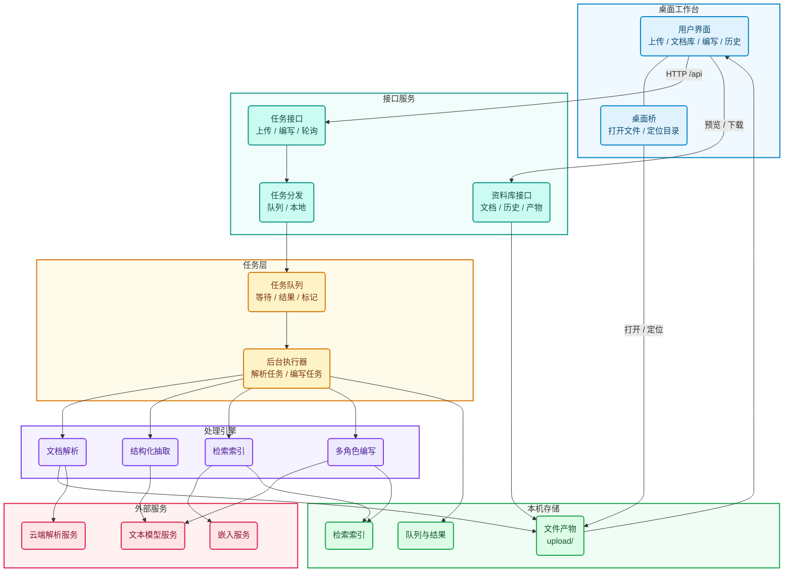

#### 2.2 工作机制

1. **桌面工作台**只负责交互与状态展示，不直接处理文档；
2. 所有长耗时操作通过**接口服务**创建任务，由**任务层**异步执行；
3. **处理引擎**按任务类型执行解析、抽取、索引或编写；
4. 解析与编写产物写入**本机文件**，任务状态写入**队列与结果存储**；
5. 编写阶段的检索依赖**嵌入服务**与**检索索引**；
6. 云端解析、文本模型、嵌入服务都是外部依赖，失败时按各自策略降级。

#### 2.3 关键边界

- 接口服务不等待长任务完成；
- 工作台不直接访问文件系统，桌面打开能力必须经过桥接与白名单；
- 任务状态有保留期，磁盘产物没有自动清理；
- 检索索引不可用时，编写仍可继续，但内容针对性下降。

---

### 3. 桌面工作台

#### 3.1 四个工作区与共享状态

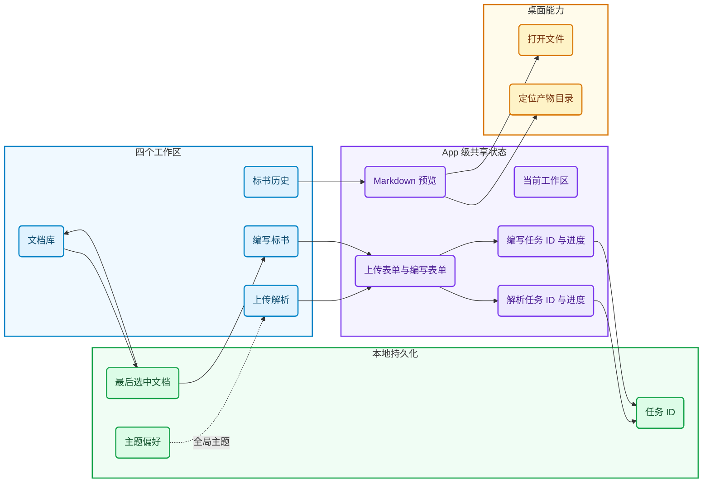

#### 3.2 工作机制

- **工作区切换不卸载任务状态**：轮询 Hook 挂在 App 层，切换页面不会中断任务；
- 上传表单、编写表单、任务 ID、历史选中项、预览弹窗共享同一份 App 状态；
- 任务 ID 与最后选中文档写入本地存储，刷新后可恢复；
- 投标人资料**不写入本地存储**，只在当前会话内保留；
- 主题在首屏脚本中提前应用，避免刷新闪烁；
- 桌面能力只在检测到桥接对象时显示，浏览器环境自动隐藏。

#### 3.3 状态保持规则

| 信息 | 是否持久化 | 说明 |
|---|---|---|
| 当前工作区 | 否 | 刷新后回到上传页 |
| 上传表单 | 否 | 刷新后清空文件选择 |
| 编写表单 | 否 | 资料不落本地 |
| 最后文档 ID | 是 | 便于继续编写 |
| 解析/编写任务 ID | 是 | 任务过期后自动清理 |
| 主题 | 是 | 深色 / 浅色 |
| 历史选中项 | 否 | 仅在当前会话 |

---

### 4. 接口服务

#### 4.1 请求进入与校验

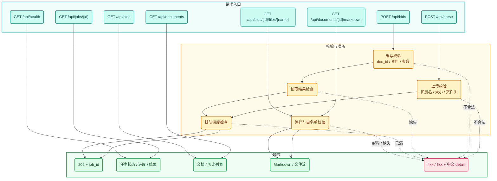

#### 4.2 上传与轮询时序

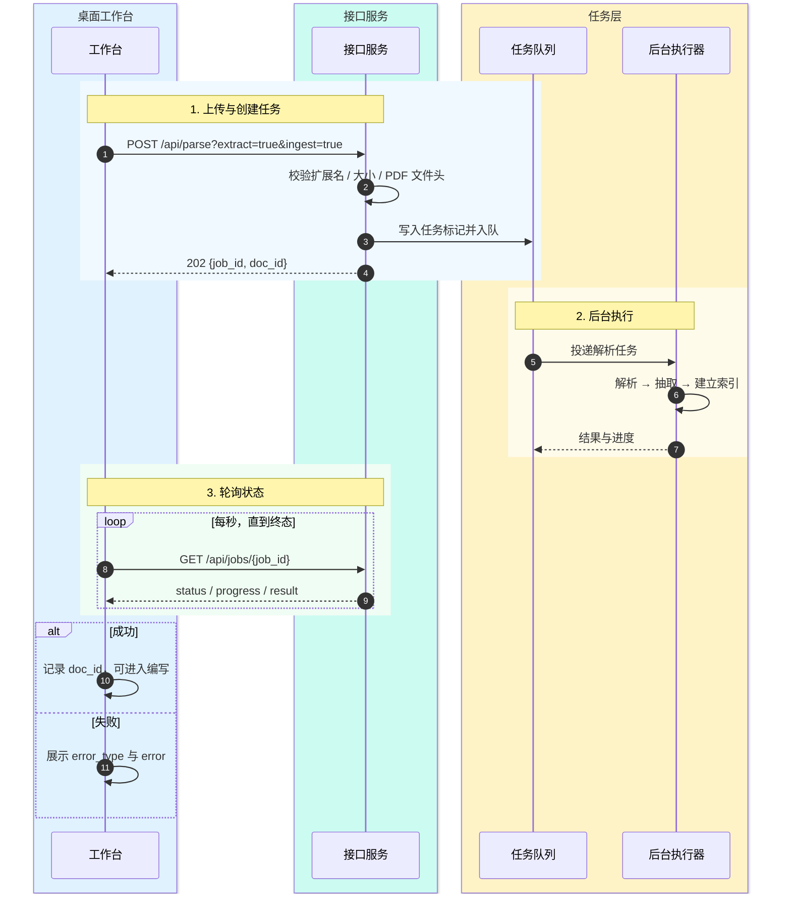

#### 4.3 工作机制

- 接口只做**校验、落盘、入队、查询**，不在请求内执行长任务；
- 上传接口先保存文件，再提交任务；提交失败时文件可能已经落盘；
- 编写接口要求 `extraction.json` 存在，否则返回 404；
- 队列深度达到上限返回 429，队列不可用返回 503；
- 产物接口只允许白名单文件，并校验路径位于对应根目录内；
- 所有错误以中文 `detail` 返回，参数校验错误为标准字段数组。

---

### 5. 任务分发与队列

#### 5.1 两种任务后端

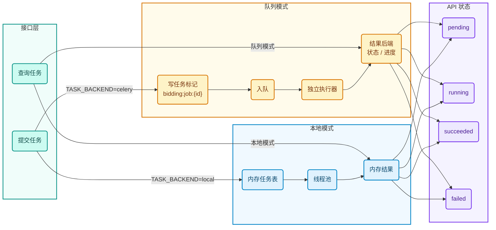

#### 5.2 工作机制

1. 接口生成唯一 `job_id`；
2. 队列模式先写任务标记，再入队；
3. 执行器消费任务，状态从 `pending` 进入 `running`；
4. 执行器更新进度与最终结果；
5. 接口把队列状态映射为四种 API 状态；
6. 本地模式用内存任务表和线程池，重启即丢失，仅用于测试与无队列环境。

#### 5.3 状态映射

| 队列状态 | API 状态 | 含义 |
|---|---|---|
| `PENDING` / `RECEIVED` | `pending` | 已创建，等待执行 |
| `STARTED` / `PROGRESS` / `RETRY` | `running` | 执行中或重试中 |
| `SUCCESS` | `succeeded` | 完成 |
| `FAILURE` / `REVOKED` | `failed` | 失败或撤销 |
| 其他 | `running` | 未知状态按执行中处理 |

#### 5.4 状态迁移

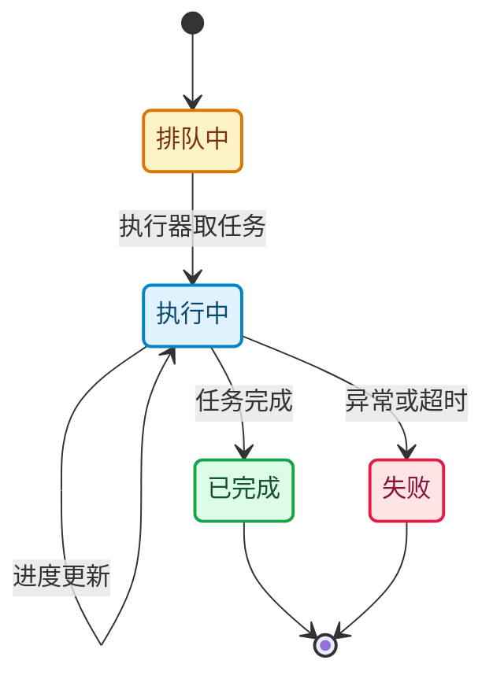

状态图的状态本身为圆角矩形；颜色对应“等待、执行、成功、失败”。

#### 5.5 队列限制

- 队列模式按“等待队列长度”判断是否已满；
- 本地模式按“pending + running”数量判断；
- 达到上限返回 429；
- 执行器未启动时，任务保持 `pending`，不会自动失败。

---

### 6. 后台执行器与任务

#### 6.1 任务执行流程

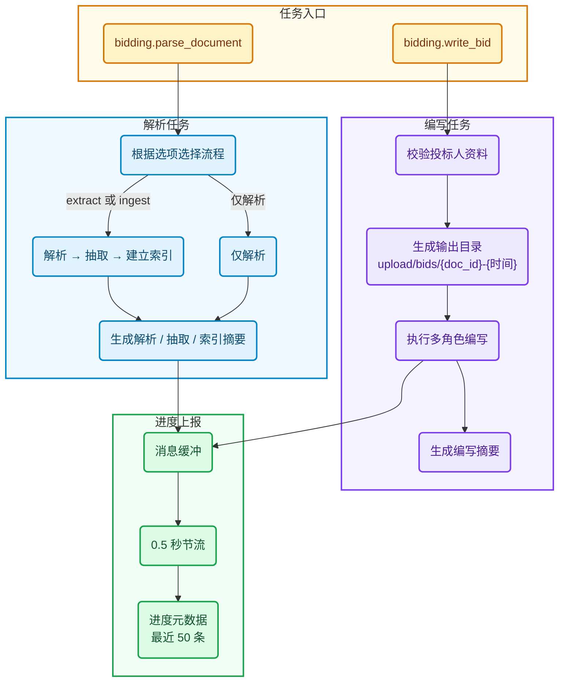

#### 6.2 工作机制

- 解析任务：根据 `extract` / `ingest` 选择完整流水线或仅解析；
- 编写任务：校验资料、生成输出目录、调用编写编排、返回摘要；
- 所有任务共享同一套进度上报：
  - 事件消息进入缓冲；
  - 0.5 秒内只上报一次；
  - 上报内容为最近 50 条；
  - 上报失败不影响主任务；
- 任务结束把最近进度写入最终结果；
- 单个解析单元失败可以继续；编写章节失败会使任务失败。

#### 6.3 输出

| 任务 | 返回值 |
|---|---|
| 解析 | 解析摘要、抽取摘要、索引摘要、起止时间 |
| 编写 | 编写摘要（覆盖、章节得分、占位符、产物路径）、起止时间 |

---

### 7. 文档解析组件

#### 7.1 解析主流程

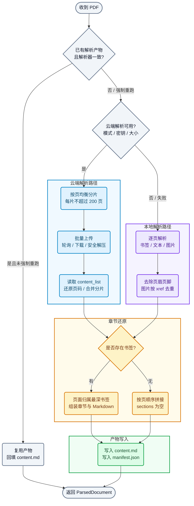

#### 7.2 工作机制

1. 先检查缓存：解析器一致且未强制重跑 → 复用；
2. 云端可用时：分片 → 批量上传 → 轮询 → 下载 → 解压 → 合并；
3. 云端不可用或失败：本地逐页解析；
4. 无论哪条路径，最终都进入“章节还原”：
   - 有书签：页面归属最深书签，组装章节；
   - 无书签：按页顺序拼接，章节为空；
5. 写入全文与摘要，返回标准解析对象。

#### 7.3 关键规则

| 规则 | 说明 |
|---|---|
| 缓存复用 | 解析器变化或强制重跑时失效 |
| 云端回退 | 认证失败、超时、超限、网络错误均可回退 |
| 分片上限 | 单文件 200 页，均衡拆分 |
| 无书签 | 不阻断解析，正文仍保留 |
| 图片 | 本地按 xref 去重；云端按分片前缀复制 |
| 产物 | `content.md` 为权威全文；`manifest.json` 不重复保存全文 |

---

### 8. 结构化抽取组件

#### 8.1 Map-Reduce 抽取流程

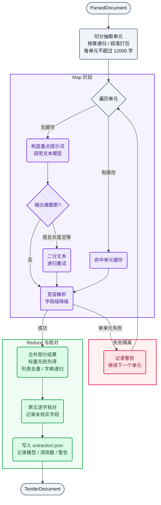

#### 8.2 工作机制

1. **切分**：优先按“第X章”递归细分；没有章节时全文按段落切分；
2. **Map**：每个单元独立调用模型，按章节类型选择重点字段；
3. **缓存**：单元结果写入 `extraction_parts/NNN.json`，解析器或提示词版本变化时整体失效；
4. **截断**：输出被截断且长度足够时，二分文本递归重试；
5. **容错**：列表 `null`、分值 `"30分"`、中文布尔、类别近义词都在 schema 层归一化；
6. **Reduce**：标量先到先得，列表按标题/名称/因素去重，字典递归合并；
7. **核对**：关键字段与原文逐字比对，只报告、不清空；
8. **落盘**：写入 `extraction.json` 与元信息。

#### 8.3 失败隔离

- 单个单元失败 → 记录警告，继续；
- 所有单元失败 → 抛错，任务失败；
- 部分成功 → 使用成功部分生成结果；
- 缓存损坏 → 重新抽取该单元。

---

### 9. 检索索引组件

#### 9.1 入库与检索

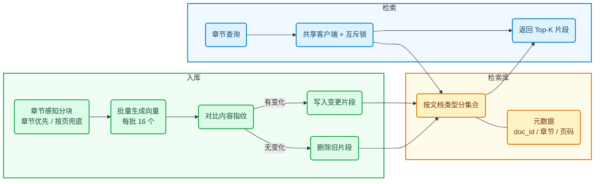

#### 9.2 分块规则

- 有章节：以章节为单位，超长时才在句末标点处切分；
- 无书签：按页拆分全文，跳过目录页与少于 10 字的页码/页脚；
- 每个片段带项目名、章节面包屑、页码提示与内容指纹；
- 片段 id 为 `doc_id:index:04d`。

#### 9.3 幂等入库

1. 查询当前文档已有片段；
2. 对比片段 id 与内容指纹；
3. 只对新增或内容变化的片段生成向量；
4. 批量写入；
5. 删除不再存在的旧片段；
6. 返回新增、更新、删除、未变与集合总数。

#### 9.4 检索规则

- 每次编写创建一个共享检索器；
- 查询用互斥锁串行化，避免并发创建多个客户端；
- 检索可按 `doc_id` 过滤；
- 默认返回 6 个片段；
- 检索失败返回空列表，不阻断写作。

---

### 10. 投标编写编排组件

#### 10.1 状态图编排

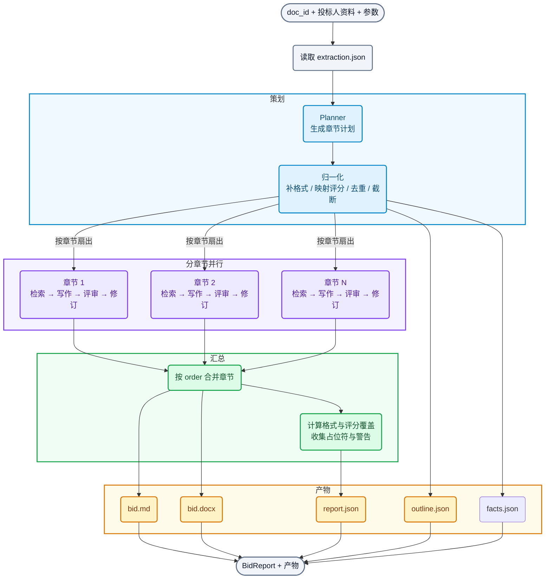

#### 10.2 工作机制

1. 读取结构化抽取结果；
2. Planner 生成章节计划；
3. 归一化：
   - 去重；
   - 补缺失的投标文件格式条目；
   - 把评分因素映射到章节；
   - 按章节数量截断；
4. 按章节并行扇出；
5. 每个章节执行完整的写作循环；
6. 汇总章节、生成 Markdown、Word 与覆盖报告；
7. 所有产物写入独立时间戳目录。

#### 10.3 章节策略

| 策略 | 行为 |
|---|---|
| `generate` | 检索原文后生成正文 |
| `llm_fill` | LLM 按固定格式填写已知信息（遗留名 `fill_template` 读取时归一化） |
| `placeholder` | 不调用模型，生成占位模板与 100 分 |

#### 10.4 章节数量限制

- 提示词默认建议不超过 25 个章节；
- 接口允许 0–50；
- 截断时优先保留 `generate` 章节；
- 截断后重新排序并重新编号。

---

### 11. 章节编写循环

#### 11.1 单章节流程

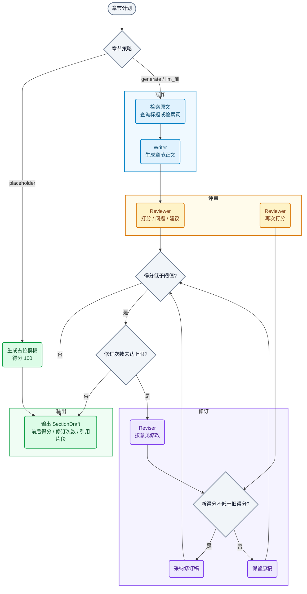

#### 11.2 单章节时序

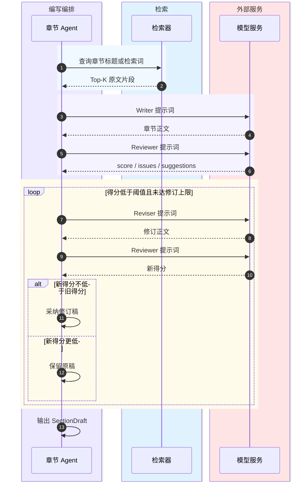

#### 11.3 工作机制

- 占位章节不调用模型，直接返回 100 分；
- 检索失败 → 空引用继续；
- 评审失败 → 0 分并记录问题；
- 修订只在“低于阈值且未达次数上限”时进行；
- 每次修订都重新评审；
- 只有新得分不低于当前最佳时才采纳；
- `revisions` 记录尝试次数，不是采纳次数。

---

### 12. 文档库、历史与产物服务

#### 12.1 列表、预览与下载

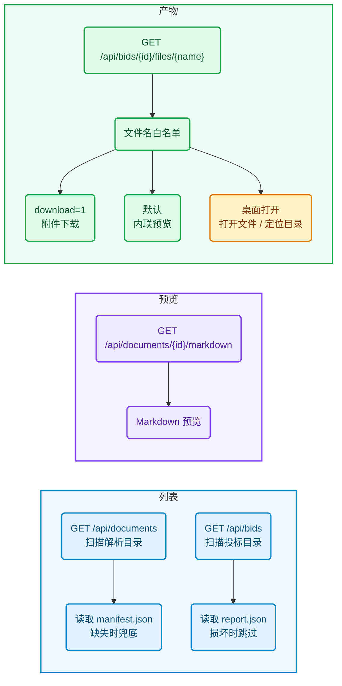

#### 12.2 产物下载时序

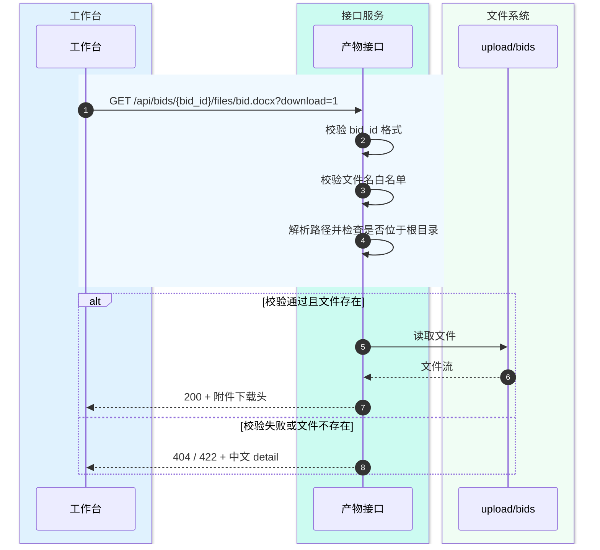

#### 12.3 工作机制

- 文档库扫描 `upload/parsed/` 一级目录，按修改时间倒序，最多 200 条；
- 标书历史扫描 `upload/bids/` 一级目录，读取 `report.json`，损坏则跳过，最多 100 条；
- Markdown 预览返回 `content.md`，inline 展示；
- 产物下载只允许 `bid.md`、`bid.docx`、`report.json`、`outline.json`、`facts.json`；
- 路径必须位于对应产物目录内，非法标识返回 422，文件缺失返回 404；
- 桌面模式可进一步调用系统打开能力，浏览器模式仅保留预览与下载。

---

### 13. 桌面桥与 IPC

#### 13.1 打开文件与定位目录

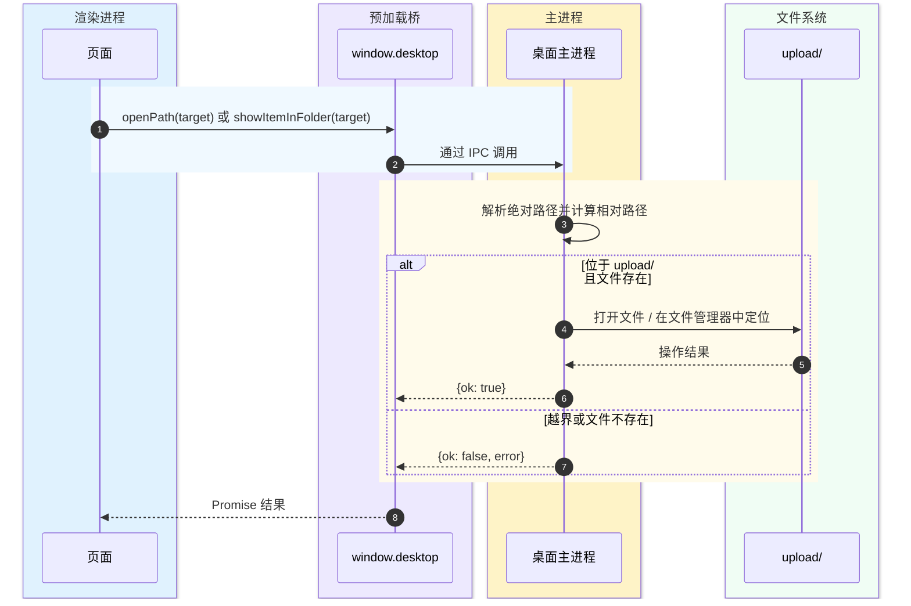

#### 13.2 工作机制

- 页面只能通过预加载桥调用两个受限能力：
  - `openPath`：用系统默认程序打开文件；
  - `showItemInFolder`：在文件管理器中定位文件；
- 主进程先解析绝对路径，再判断是否位于白名单根目录；
- 白名单默认是仓库 `upload/`，可用环境变量覆盖；
- 越界、跨盘符、文件不存在都返回失败结果；
- 页面无法直接获得 Node 能力或通用文件系统 API；
- 浏览器环境不显示桌面按钮。

---

### 14. 命令行组件

#### 14.1 子命令与流水线复用

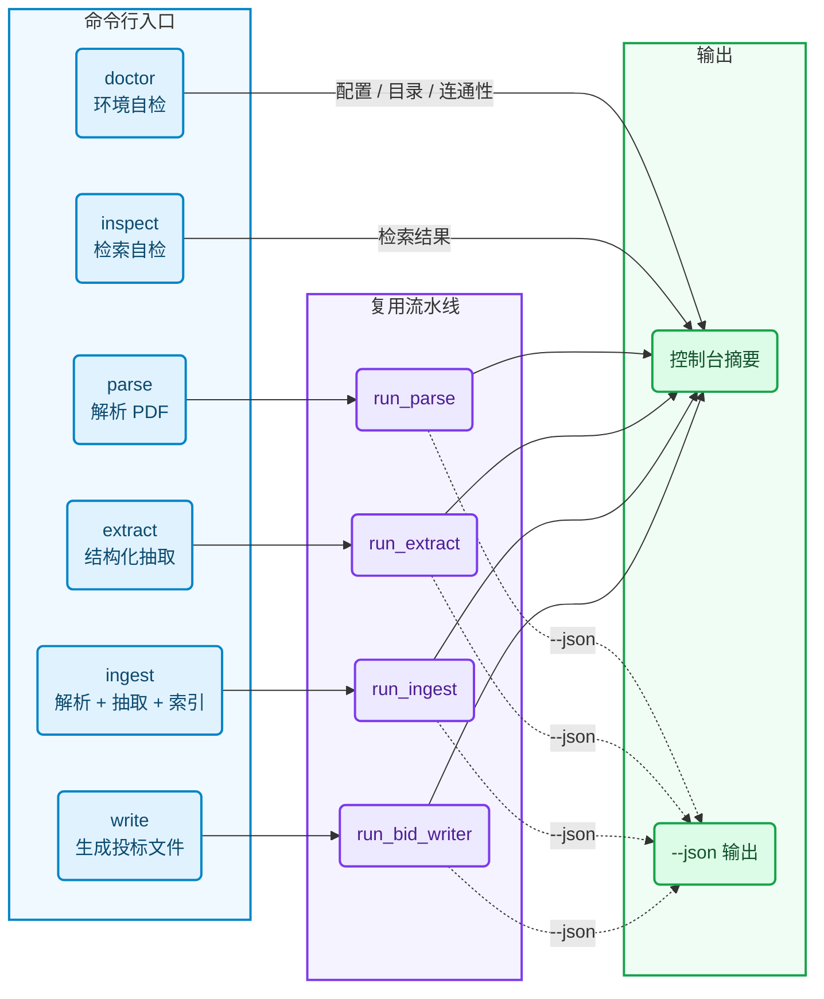

#### 14.2 工作机制

- 命令行与接口复用同一套 `run_parse` / `run_extract` / `run_ingest` / `run_bid_writer`；
- `doctor` 检查配置、目录与外部服务；
- `parse` / `extract` / `ingest` 支持 `--force`；
- `inspect` 可列出索引内容或执行查询；
- `write` 支持资料文件、输出目录、修订参数、章节数与 Word 开关；
- `--json` 输出适合脚本消费的摘要。

---

### 15. 配置与健康检查

#### 15.1 配置装配

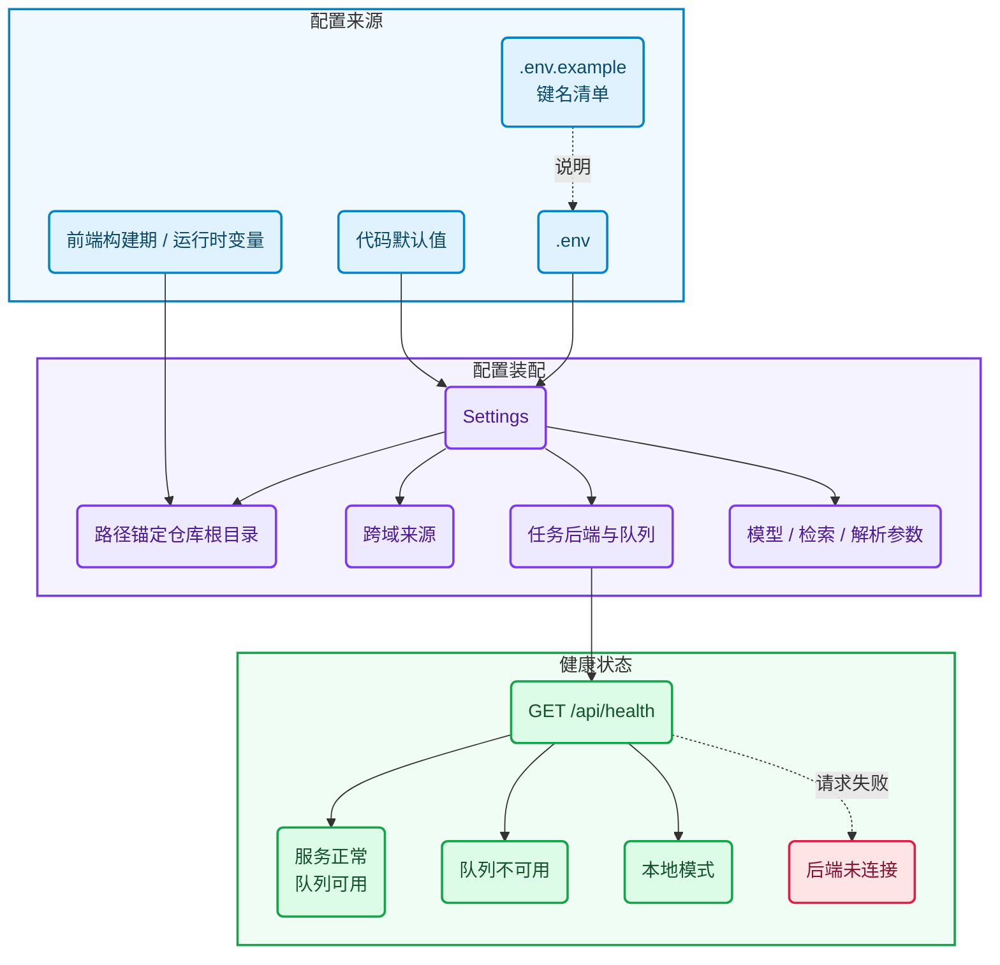

#### 15.2 工作机制

- 后端配置从 `.env` 读取，字段名大小写不敏感，额外字段忽略；
- 路径相对仓库根目录解析，不依赖当前工作目录；
- `.env.example` 是键名与默认值的权威清单；
- 前端接口地址在开发态走同源代理，打包后回退到本机地址，可用构建期变量覆盖；
- 健康检查只代表接口与队列状态，不代表执行器已启动；
- 任务是否真正执行，以任务状态为准。

#### 15.3 健康状态

| 状态 | 条件 | 前端展示 |
|---|---|---|
| 服务正常 | `broker_ok=true` | 绿色 |
| 队列不可用 | `broker_ok=false` | 红色 |
| 本地模式 | `broker_ok=null` | 灰色 |
| 后端未连接 | 请求失败 | 红色并提示启动命令 |

---

### 16. 存储层

#### 16.1 文件、队列与索引

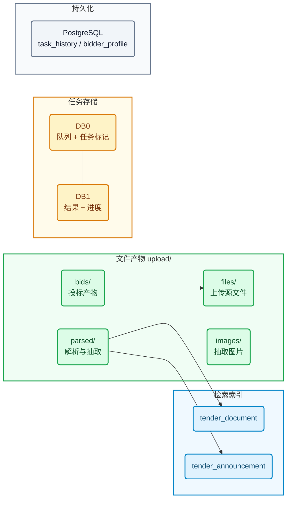

#### 16.2 工作机制

- 源文件保存为 `<doc_id>_<安全文件名>.pdf`；
- 解析产物包含 `manifest.json`、`content.md`、`extraction.json`、单元缓存与原始文件；
- 投标产物每次生成独立时间戳目录，不覆盖历史；
- 队列模式使用 DB0 存队列与任务标记，DB1 存结果与进度；
- 检索索引按文档类型分集合；
- PostgreSQL 仅保留配置，当前没有实际读写。

#### 16.3 数据保留

| 数据 | 保留 |
|---|---|
| 文件产物 | 持久，需手工清理 |
| 队列结果 | 默认 24 小时 |
| 本地内存任务 | 进程结束即丢失 |
| 检索索引 | 持久，需手工清理 |
| 前端本地记录 | 文档 ID、任务 ID、主题 |

---

### 17. 外部服务

#### 17.1 依赖与降级

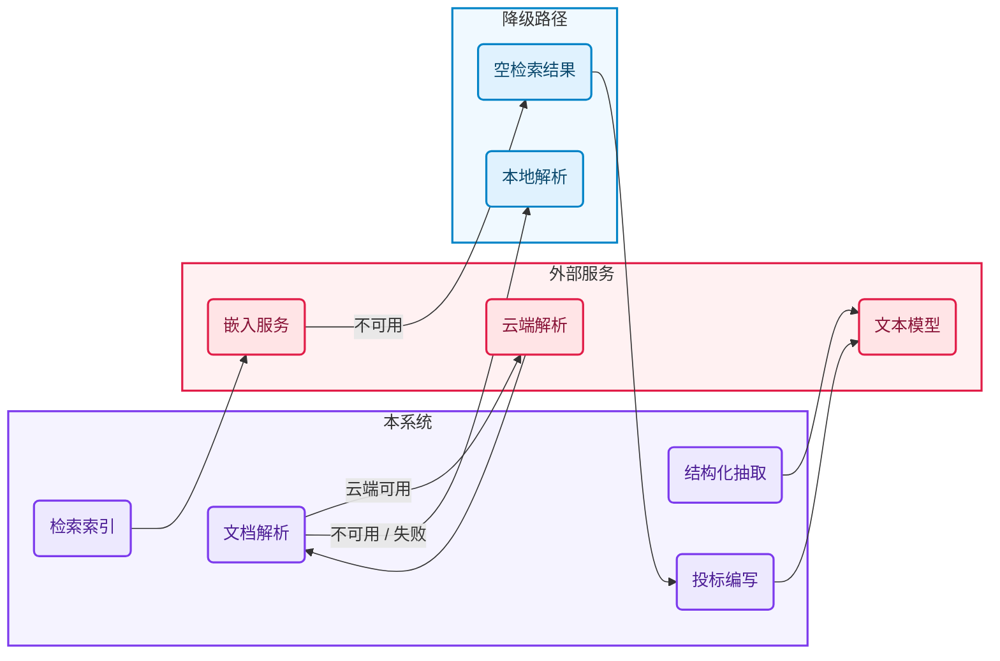

#### 17.2 工作机制

| 服务 | 用途 | 失败影响 | 降级 |
|---|---|---|---|
| 云端解析 | 版面、表格、扫描件解析 | 解析质量下降 | 回退本地解析 |
| 文本模型 | 抽取、策划、写作、评审、修订 | 任务失败或章节质量下降 | 无自动替代 |
| 嵌入服务 | 建立索引与检索 | 无法入库或检索为空 | 编写可无检索继续 |

#### 17.3 超时与重试

- 云端解析：请求、下载、轮询分别有超时（`MINERU_TIMEOUT`/`MINERU_DOWNLOAD_TIMEOUT`）；
  四个 httpx 调用统一经 `RetryPolicy` 做传输重试（T-026），仅 429/5xx 与传输层异常
  （超时、连接错误）可重试，4xx 鉴权/参数错误与 2xx 业务错误立即失败；次数
  `MINERU_MAX_RETRIES`（默认 3，0 关闭）、退避 `base*2^n + [0,base) 抖动`
  （`MINERU_RETRY_BACKOFF_BASE_SECONDS` 默认 1.0），合法 `Retry-After` 优先；
- 文本模型：OpenAI SDK 内置传输重试，次数由 `LLM_MAX_RETRIES`（默认 2）显式配置，
  连接、超时、408/409、429、5xx 可重试，其余 4xx 直接失败；
- 嵌入服务：SDK 重试次数 `EMBEDDING_MAX_RETRIES`（默认 10），失败会使入库或检索初始化失败；
- 所有重试都有次数上限，避免无限等待；重试耗尽后异常类型与消息不变，auto 模式仍按
  既有链路降级本地 PyMuPDF，cloud/strict 模式仍抛 `ParseError`（退出码 4）。

---

### 18. 测试与离线保障

#### 18.1 测试守卫与分层

```mermaid
flowchart TB
  subgraph sgGuard["离线守卫"]
    direction TB
    Socket("拦截外部网络<br/>放行回环")
    Tmp("upload / 索引目录<br/>重定向到临时目录")
    Fake("假模型 / 假嵌入<br/>内存索引")
  end

  subgraph sgSuite["测试套件"]
    direction TB
    Suite("离线测试入口")
    Toc("书签 / 归属 / 目录页")
    Parse("分片 / 合并 / 本地解析")
    Extract("单元 / 容错 / 合并 / 缓存")
    Vector("分块 / 幂等入库 / 检索")
    API("上传 / 任务 / 资料库 / 产物")
    Bid("大纲 / 修订 / 覆盖 / Word")
    Suite --> Toc
    Suite --> Parse
    Suite --> Extract
    Suite --> Vector
    Suite --> API
    Suite --> Bid
  end

  subgraph sgBuild["前端门禁"]
    direction TB
    TSC("类型检查")
    Build("生产构建")
    TSC --> Build
  end

  Socket --> Suite
  Tmp --> Suite
  Fake --> Suite
  Suite --> Result("全量测试通过")
  Build --> Result

  classDef guard fill:#ffe4e6,stroke:#e11d48,stroke-width:2px,color:#881337
  classDef suite fill:#e0f2fe,stroke:#0284c7,stroke-width:2px,color:#0c4a6e
  classDef build fill:#fef3c7,stroke:#d97706,stroke-width:2px,color:#78350f
  classDef result fill:#dcfce7,stroke:#16a34a,stroke-width:2px,color:#14532d
  class Socket,Tmp,Fake guard
  class Suite,Toc,Parse,Extract,Vector,API,Bid suite
  class TSC,Build build
  class Result result

  style sgGuard fill:#fff1f2,stroke:#e11d48,stroke-width:2px
  style sgSuite fill:#f0f9ff,stroke:#0284c7,stroke-width:2px
  style sgBuild fill:#fffbeb,stroke:#d97706,stroke-width:2px
```

#### 18.2 工作机制

- 任何外部网络连接在测试中直接失败，避免误用真实额度；
- 上传、索引目录重定向到临时目录，不污染仓库；
- 使用合成 PDF、假模型、假嵌入与内存索引；
- 测试覆盖结构、解析、抽取、索引、接口、任务、编写、导出；
- 前端没有自动化交互测试，质量门禁为类型检查与生产构建。

---

### 19. 端到端时序

#### 19.1 从上传到产物下载

```mermaid
sequenceDiagram
  autonumber
  box rgb(224, 242, 254) 桌面工作台
    participant UI as 工作台
  end
  box rgb(204, 251, 241) 接口服务
    participant API as 接口服务
  end
  box rgb(254, 243, 199) 任务层
    participant Q as 任务队列
    participant W as 后台执行器
  end
  box rgb(237, 233, 254) 处理引擎
    participant P as 解析 / 抽取 / 索引
    participant B as 编写编排
  end
  box rgb(255, 228, 230) 外部服务
    participant X as 模型 / 嵌入 / 云端
  end

  rect rgb(240, 249, 255)
    Note over UI,API: 1. 文档接入
    UI->>API: 上传 PDF（extract + ingest）
    API->>Q: 创建解析任务
    API-->>UI: 202 + job_id + doc_id
  end

  rect rgb(255, 251, 235)
    Note over Q,P: 2. 解析、抽取、索引
    Q->>W: 消费解析任务
    W->>P: 解析 → 抽取 → 建立索引
    P->>X: 云端解析 / 文本模型 / 嵌入
    X-->>P: 结果
    P-->>W: 摘要
    W-->>Q: 结果与进度
  end

  rect rgb(240, 253, 244)
    Note over UI,API: 3. 轮询解析任务
    loop 每秒，直到终态
      UI->>API: 查询任务
      API-->>UI: 状态 / 进度
    end
  end

  rect rgb(245, 243, 255)
    Note over UI,B: 4. 编写投标文件
    UI->>API: 创建编写任务（doc_id + 资料）
    API->>Q: 入队
    Q->>W: 消费编写任务
    W->>B: 策划 → 分章节 → 汇总
    B->>X: 检索 + 写作 + 评审 + 修订
    X-->>B: 章节与评分
    B-->>W: bid.md / docx / report.json
    W-->>Q: 结果
  end

  rect rgb(255, 241, 242)
    Note over UI,API: 5. 查看与交付
    UI->>API: 预览 / 下载产物
    API-->>UI: Markdown / Word / 报告
  end
```

#### 19.2 端到端检查点

| 阶段 | 成功标志 | 失败表现 |
|---|---|---|
| 上传 | 202 + `job_id` + `doc_id` | 400 / 413 / 422 / 429 / 503 |
| 解析 | `status=succeeded`，`result` 有值 | `failed` + `error_type` |
| 抽取 | `extraction` 有值 | `extraction=null` 或任务失败 |
| 索引 | `ingest.total` 增加 | 任务失败或无正文 |
| 编写 | `bid` 有值，产物目录存在 | `failed` + `error` |
| 下载 | 200 + 正确文件类型 | 404 / 422 |
| 桌面打开 | `{ok:true}` | `{ok:false,error}` |

---

### 20. 组件与代码映射

| 组件 | 主要代码 | 职责 |
|---|---|---|
| 桌面工作台 | `frontend/src/App.tsx`、`frontend/src/pages/`、`frontend/src/lib/` | 四个工作区、共享状态、轮询、表单、结果展示 |
| 接口服务 | `api/routes.py`、`api/library.py`、`api/schemas.py` | 上传、编写、轮询、资料库、产物 |
| 任务分发 | `api/dispatch.py`、`api/jobs.py` | 队列/本地后端、任务状态、结果映射 |
| 后台执行器 | `src/tasks.py`、`src/celery_app.py` | 任务定义、进度、解析/编写执行 |
| 文档解析 | `src/parsing/` | 书签、分片、云端/本地解析、合并、产物 |
| 结构化抽取 | `src/extraction/` | 单元切分、提示词、Schema、合并、核对、缓存 |
| 检索索引 | `src/vectorstore/` | 分块、嵌入、幂等入库、检索 |
| 编写编排 | `src/bid_writer/graph.py`、`agents.py` | 策划、扇出、写作、评审、修订、汇总 |
| 覆盖报告 | `src/bid_writer/assembly.py` | 格式/评分覆盖、占位符、摘要 |
| Word 导出 | `src/bid_writer/docx_export.py` | Markdown 转 Word |
| 桌面桥 | `frontend/electron/main.cjs`、`preload.cjs` | IPC、路径白名单、打开文件/定位 |
| 命令行 | `src/cli/` | 解析、抽取、索引、检索、编写、自检 |
| 配置 | `src/config.py`、`.env.example` | 环境配置、路径、参数 |
| 测试 | `tests/` | 离线测试、守卫、夹具 |

---

### 21. 图形维护约定

1. 新增组件时，优先新增**独立子图**，并使用本文档的颜色图例；
2. 动作节点统一使用圆角矩形 `id("...")`；
3. 子图必须使用显式 ID，才能用 `style` 着色；
4. 判断节点只在真正分支时使用菱形，避免图形过度复杂；
5. 时序图用 `box` 区分参与方，用 `rect` 区分阶段；
6. 同一张图内颜色不超过 6 种，避免视觉噪声；
7. 标签避免出现未转义的 `<`、`>`，防止被当作 HTML 标签；
8. 新增外部依赖或降级路径时，同步更新“外部服务”与“端到端时序”。

---

*文档结束。*

---

## 第四部分　开发流程与验证门禁（原《开发流程》）

> 文档版本：1.0  
> 定位：面向开发协作者的「开发代码主要流程任务」约定。仓库根目录 `AGENTS.md` 承载工程协作规则（开发约定与完成定义），本文档只关注开发任务与验收。  
> 配套：`README.md`（用法与命令）、`api-contract.md`（接口与数据规范）、`tech-decisions.md`（版本快照）、`tech-decisions.md`（分工/里程碑/ADR）、`architecture.md`（模块与数据流）。

---

### 1. 文档说明

本文档回答「开发本系统代码时，按什么顺序、完成哪些任务、每步怎么算完成、如何验证」。

模块的职责/输入/输出/依赖见 `architecture.md`，接口与数据契约见 `api-contract.md`，本文档只关注「开发任务与验收」。

---

### 2. 开发总原则

| 原则 | 说明 |
|---|---|
| 小步验证 | 每完成一个任务就跑到对应测试/命令，不攒到最后一次性联调 |
| 分层解耦 | `api/` 只收请求→入队→查结果；业务逻辑在 `src/`，靠任务队列解耦 |
| 先契约后实现 | 先定模块输入输出（如 `ParsedDocument`、`extraction.json`），再填实现 |
| 不脑补业务 | 招标业务规则不确定时先提「待确认问题」，不臆测 |
| 版本以锁文件为准 | `uv.lock` / `package-lock.json` > `pyproject.toml` / `package.json` > 文档快照 |

---

### 3. 主要流程任务

#### M1 环境与骨架 ✅（已完成）

依赖安装与项目骨架。`uv sync`、`npm install`、`npm run build` 均已通过；后端可导入、Electron 二进制已落地。

#### M2 文档接入（解析 → 抽取 → 索引 → CLI）

| 编号 | 任务 | 涉及文件 | 完成标准 | 验证方式 |
|---|---|---|---|---|
| T2.1 | 配置层 | `src/config.py`、`.env.example` | 全部配置键有类型化字段与默认值，路径锚定仓库根 | `python -m src.cli doctor` 可读配置 |
| T2.2 | 错误层级 | `src/errors.py` | 异常层级 + CLI 退出码（0/3/4/5/6/130） | 单测 |
| T2.3 | 文档解析 | `src/parsing/`（toc/splitter/mineru_client/local_parser/builder） | PDF → `ParsedDocument`（`content.md`+`manifest.json`+`images/`），云端/本地双路径统一 | 解析测试 + `cli parse` |
| T2.4 | 结构化抽取 | `src/extraction/` | `ParsedDocument` → `extraction.json`（含 `ungrounded_fields`） | 抽取测试 + `cli extract` |
| T2.5 | 检索索引 | `src/vectorstore/` | 章节感知分块 + 火山方舟嵌入 + Chroma 幂等入库 | 索引测试 + `cli ingest/inspect` |
| T2.6 | 流水线编排 | `src/pipeline.py` | `run_parse` / `run_extract` / `run_ingest` 串起三阶段 | `cli ingest` 端到端跑通 |
| T2.7 | 命令行 | `src/cli/` | `doctor/parse/extract/ingest/inspect` 子命令与退出码 | CLI 退出码测试 |

#### M3 异步接口

| 编号 | 任务 | 涉及文件 | 完成标准 | 验证方式 |
|---|---|---|---|---|
| T3.1 | 任务定义 | `src/tasks.py`、`src/celery_app.py` | 注册 `bidding.parse_document`、`bidding.write_bid` | worker 启动无报错 |
| T3.2 | 接口路由 | `api/routes.py`、`api/library.py`、任务分发器 | `POST /api/parse`、`POST /api/bids` 返 202；`GET /api/jobs/{id}` 轮询 | 接口测试 + curl |
| T3.3 | 持久化接入（ADR-008） | `src/db/`（模型/会话/repository）、接口读写 | PostgreSQL 持久化「投标人资料 + 任务历史」，跨重启可查 | 接口测试 + 重启验证 |

#### M4 投标编写

| 编号 | 任务 | 涉及文件 | 完成标准 | 验证方式 |
|---|---|---|---|---|
| T4.1 | 编写编排 | `src/bid_writer/` | 多角色工作流 planner→writer→reviewer→reviser，线程池章节级扇出并行 | 编写测试 |
| T4.2 | Word 导出 | `src/bid_writer/`（python-docx） | `bid.md` → `bid.docx`，失败不阻断 Markdown 与报告 | 编写测试 |

#### M5 桌面工作台

| 编号 | 任务 | 涉及文件 | 完成标准 | 验证方式 |
|---|---|---|---|---|
| T5.1 | 四工作区 UI | `frontend/src/` | 上传解析/文档库/编写/历史 四区交互 | `npm run build` + 手工 |
| T5.2 | 桌面桥 IPC | `frontend/electron/`（main.cjs/preload.cjs） | preload 暴露 `openPath`/`showItemInFolder`，主进程白名单校验 | `ELECTRON_LOAD_DIST=1 npm run electron` 验证 |

#### M6 验收

| 任务 | 完成标准 | 验证方式 |
|---|---|---|
| 全量回归 | pytest 全绿 + `tsc --noEmit` 通过 | `uv run pytest`、`npm run build` |
| 手工验收 | 走通「上传→解析→抽取→编写→下载/打开」 | 按 `README.md` 操作 |

---

### 4. 任务依赖关系

```text
T2.1 配置 ──────────────────────────► 全部后端任务的前置
T2.3 解析 ──► T2.4 抽取 ──► T2.5 索引      （数据流顺序，强依赖）
T2.3~T2.5 ──► T2.6 流水线 ──► T2.7 CLI
T2.6 ──► M3 接口（parse 任务内部调 pipeline）
T2.4 + T2.5 ──► M4 编写
M3 接口 ──► M5 前端（前端依赖接口契约）
T3.3 持久化 ──► M3 任务历史查询 + M4 投标人资料输入
```

---

### 5. 验证门禁汇总

| 阶段 | 统一验证命令 |
|---|---|
| M2 | `uv run pytest` + `uv run python -m src.cli ingest "upload/files/xxx.pdf"` |
| M3 | `uv run pytest` + 启动 Redis/worker/API 后 curl 提交并轮询 |
| M4 | `uv run pytest -k write` + `uv run python -m src.cli write <doc_id> --profile examples/bidder_profile.example.json` |
| M5 | `npm run build` + `npm run dev`/`npm run electron` 手工走查 |
| M6 | `uv run pytest`（全量）+ `npm run build` + 手工验收清单 |

---

*文档结束。*
