# 招标文件多智能体系统 · 组件工作机制

> 版本快照：2026-10-17  
> 适用代码版本：`00bdc6d` 及之后  
> 图形规范：中文标签、现代 Mermaid 语法、圆角矩形为主、不同子图使用不同颜色。  
> 配套文档：`开发文档.md`、`技术栈.md`、`核心算法.md`。

---

## 1. 阅读说明

### 1.1 目标

本文档用图解方式说明系统各组件的**职责、输入输出、内部步骤与协作关系**，覆盖：

- 桌面工作台；
- 接口服务；
- 任务分发与队列；
- 后台执行器；
- 文档解析；
- 结构化抽取；
- 检索索引；
- 投标编写编排；
- 章节编写循环；
- 文档库、历史与产物服务；
- 桌面桥与 IPC；
- 命令行；
- 配置与健康检查；
- 存储层；
- 外部服务；
- 测试与离线保障；
- 端到端完整链路。

### 1.2 图形约定

| 图形 | 含义 |
|---|---|
| 圆角矩形 | 动作、组件、数据、状态 |
| 胶囊形 | 流程开始/结束 |
| 菱形 | 条件判断 |
| 子图 | 同一职责范围的组件分组 |
| 虚线箭头 | 异步、可选、降级或辅助关系 |

> Mermaid 中圆角矩形的写法为 `id("标签")`；开始/结束使用 `id(["标签"])`。  
> 判断节点使用 `id{"条件"}`；状态图的状态默认即为圆角。

### 1.3 颜色图例

不同颜色用于区分组件语义，不代表优先级：

| 语义 | 节点填充 | 节点描边 | 节点文字 | 子图填充 |
|---|---|---|---|---|
| 前端 / 工作台 | `#e0f2fe` | `#0284c7` | `#0c4a6e` | `#f0f9ff` |
| 接口 / 协议 | `#ccfbf1` | `#0d9488` | `#134e4a` | `#f0fdfa` |
| 任务 / 队列 | `#fef3c7` | `#d97706` | `#78350f` | `#fffbeb` |
| 执行 / 编排 | `#ede9fe` | `#7c3aed` | `#4c1d95` | `#f5f3ff` |
| 存储 / 成功 | `#dcfce7` | `#16a34a` | `#14532d` | `#f0fdf4` |
| 外部 / 风险 | `#ffe4e6` | `#e11d48` | `#881337` | `#fff1f2` |
| 中性 / 辅助 | `#f1f5f9` | `#64748b` | `#0f172a` | `#f8fafc` |

### 1.4 使用的 Mermaid 语法

- `flowchart` / `sequenceDiagram` / `stateDiagram-v2`；
- 显式子图 ID：`subgraph sgFront["标题"]`；
- 引号标签，支持中文、标点与换行；
- `classDef` + `class` 统一节点配色；
- `style` 为子图设置填充、描边与线宽；
- 时序图使用 `box` 分组、`rect` 阶段底色、`alt` / `loop` 片段；
- 状态图使用 `classDef` 为状态着色。

---

## 2. 系统总览

### 2.1 组件地图

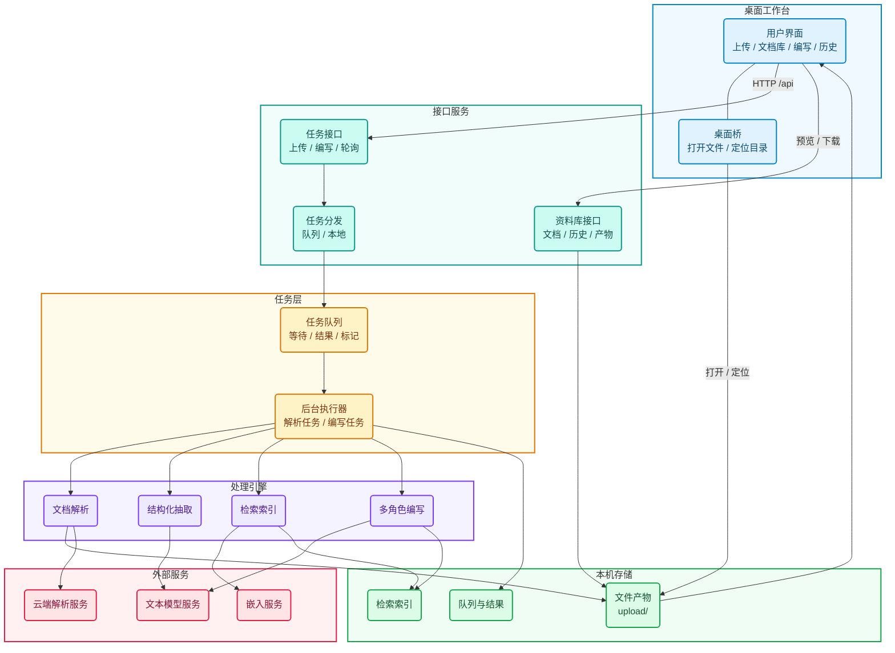

### 2.2 工作机制

1. **桌面工作台**只负责交互与状态展示，不直接处理文档；
2. 所有长耗时操作通过**接口服务**创建任务，由**任务层**异步执行；
3. **处理引擎**按任务类型执行解析、抽取、索引或编写；
4. 解析与编写产物写入**本机文件**，任务状态写入**队列与结果存储**；
5. 编写阶段的检索依赖**嵌入服务**与**检索索引**；
6. 云端解析、文本模型、嵌入服务都是外部依赖，失败时按各自策略降级。

### 2.3 关键边界

- 接口服务不等待长任务完成；
- 工作台不直接访问文件系统，桌面打开能力必须经过桥接与白名单；
- 任务状态有保留期，磁盘产物没有自动清理；
- 检索索引不可用时，编写仍可继续，但内容针对性下降。

---

## 3. 桌面工作台

### 3.1 四个工作区与共享状态

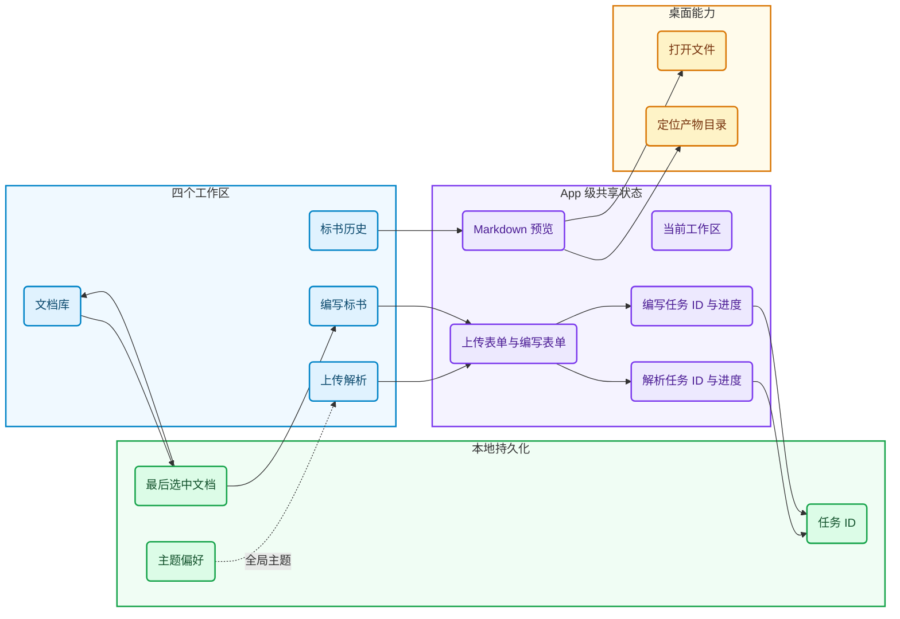

### 3.2 工作机制

- **工作区切换不卸载任务状态**：轮询 Hook 挂在 App 层，切换页面不会中断任务；
- 上传表单、编写表单、任务 ID、历史选中项、预览弹窗共享同一份 App 状态；
- 任务 ID 与最后选中文档写入本地存储，刷新后可恢复；
- 投标人资料**不写入本地存储**，只在当前会话内保留；
- 主题在首屏脚本中提前应用，避免刷新闪烁；
- 桌面能力只在检测到桥接对象时显示，浏览器环境自动隐藏。

### 3.3 状态保持规则

| 信息 | 是否持久化 | 说明 |
|---|---|---|
| 当前工作区 | 否 | 刷新后回到上传页 |
| 上传表单 | 否 | 刷新后清空文件选择 |
| 编写表单 | 否 | 资料不落本地 |
| 最后文档 ID | 是 | 便于继续编写 |
| 解析/编写任务 ID | 是 | 任务过期后自动清理 |
| 主题 | 是 | 深色 / 浅色 |
| 历史选中项 | 否 | 仅在当前会话 |

---

## 4. 接口服务

### 4.1 请求进入与校验

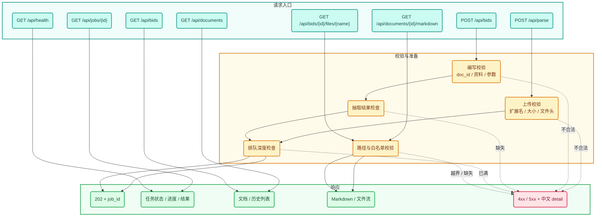

### 4.2 上传与轮询时序

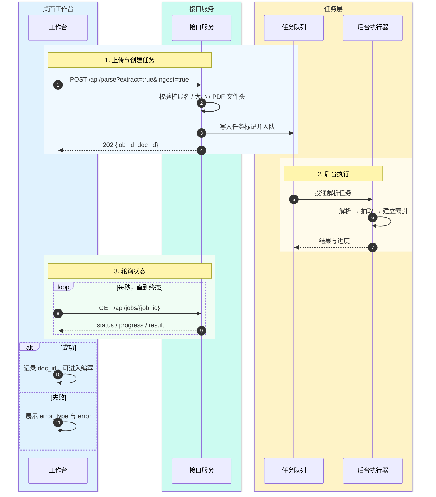

### 4.3 工作机制

- 接口只做**校验、落盘、入队、查询**，不在请求内执行长任务；
- 上传接口先保存文件，再提交任务；提交失败时文件可能已经落盘；
- 编写接口要求 `extraction.json` 存在，否则返回 404；
- 队列深度达到上限返回 429，队列不可用返回 503；
- 产物接口只允许白名单文件，并校验路径位于对应根目录内；
- 所有错误以中文 `detail` 返回，参数校验错误为标准字段数组。

---

## 5. 任务分发与队列

### 5.1 两种任务后端

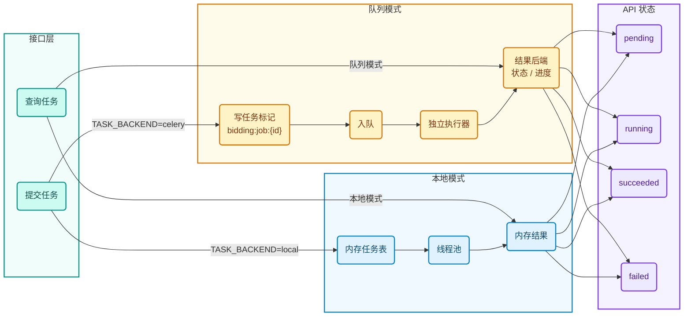

### 5.2 工作机制

1. 接口生成唯一 `job_id`；
2. 队列模式先写任务标记，再入队；
3. 执行器消费任务，状态从 `pending` 进入 `running`；
4. 执行器更新进度与最终结果；
5. 接口把队列状态映射为四种 API 状态；
6. 本地模式用内存任务表和线程池，重启即丢失，仅用于测试与无队列环境。

### 5.3 状态映射

| 队列状态 | API 状态 | 含义 |
|---|---|---|
| `PENDING` / `RECEIVED` | `pending` | 已创建，等待执行 |
| `STARTED` / `PROGRESS` / `RETRY` | `running` | 执行中或重试中 |
| `SUCCESS` | `succeeded` | 完成 |
| `FAILURE` / `REVOKED` | `failed` | 失败或撤销 |
| 其他 | `running` | 未知状态按执行中处理 |

### 5.4 状态迁移

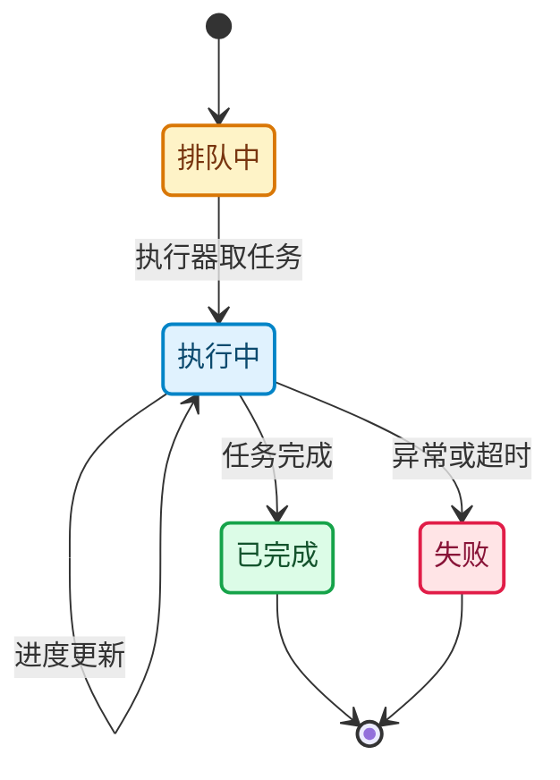

状态图的状态本身为圆角矩形；颜色对应“等待、执行、成功、失败”。

### 5.5 队列限制

- 队列模式按“等待队列长度”判断是否已满；
- 本地模式按“pending + running”数量判断；
- 达到上限返回 429；
- 执行器未启动时，任务保持 `pending`，不会自动失败。

---

## 6. 后台执行器与任务

### 6.1 任务执行流程

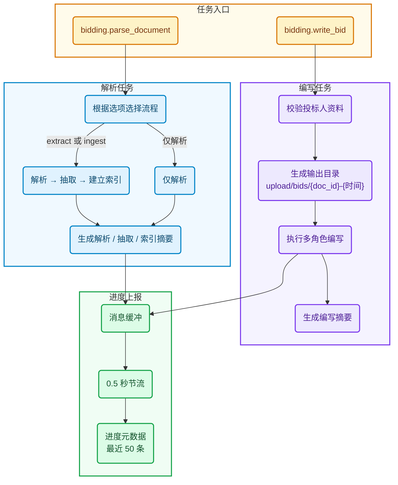

### 6.2 工作机制

- 解析任务：根据 `extract` / `ingest` 选择完整流水线或仅解析；
- 编写任务：校验资料、生成输出目录、调用编写编排、返回摘要；
- 所有任务共享同一套进度上报：
  - 事件消息进入缓冲；
  - 0.5 秒内只上报一次；
  - 上报内容为最近 50 条；
  - 上报失败不影响主任务；
- 任务结束把最近进度写入最终结果；
- 单个解析单元失败可以继续；编写章节失败会使任务失败。

### 6.3 输出

| 任务 | 返回值 |
|---|---|
| 解析 | 解析摘要、抽取摘要、索引摘要、起止时间 |
| 编写 | 编写摘要（覆盖、章节得分、占位符、产物路径）、起止时间 |

---

## 7. 文档解析组件

### 7.1 解析主流程

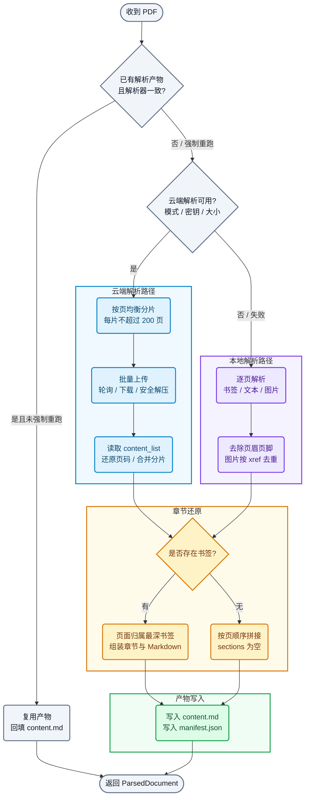

### 7.2 工作机制

1. 先检查缓存：解析器一致且未强制重跑 → 复用；
2. 云端可用时：分片 → 批量上传 → 轮询 → 下载 → 解压 → 合并；
3. 云端不可用或失败：本地逐页解析；
4. 无论哪条路径，最终都进入“章节还原”：
   - 有书签：页面归属最深书签，组装章节；
   - 无书签：按页顺序拼接，章节为空；
5. 写入全文与摘要，返回标准解析对象。

### 7.3 关键规则

| 规则 | 说明 |
|---|---|
| 缓存复用 | 解析器变化或强制重跑时失效 |
| 云端回退 | 认证失败、超时、超限、网络错误均可回退 |
| 分片上限 | 单文件 200 页，均衡拆分 |
| 无书签 | 不阻断解析，正文仍保留 |
| 图片 | 本地按 xref 去重；云端按分片前缀复制 |
| 产物 | `content.md` 为权威全文；`manifest.json` 不重复保存全文 |

---

## 8. 结构化抽取组件

### 8.1 Map-Reduce 抽取流程

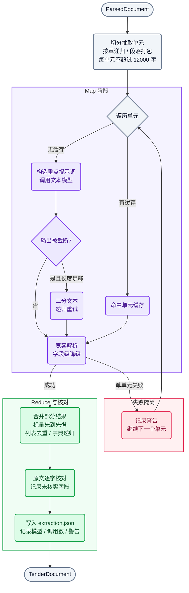

### 8.2 工作机制

1. **切分**：优先按“第X章”递归细分；没有章节时全文按段落切分；
2. **Map**：每个单元独立调用模型，按章节类型选择重点字段；
3. **缓存**：单元结果写入 `extraction_parts/NNN.json`，解析器或提示词版本变化时整体失效；
4. **截断**：输出被截断且长度足够时，二分文本递归重试；
5. **容错**：列表 `null`、分值 `"30分"`、中文布尔、类别近义词都在 schema 层归一化；
6. **Reduce**：标量先到先得，列表按标题/名称/因素去重，字典递归合并；
7. **核对**：关键字段与原文逐字比对，只报告、不清空；
8. **落盘**：写入 `extraction.json` 与元信息。

### 8.3 失败隔离

- 单个单元失败 → 记录警告，继续；
- 所有单元失败 → 抛错，任务失败；
- 部分成功 → 使用成功部分生成结果；
- 缓存损坏 → 重新抽取该单元。

---

## 9. 检索索引组件

### 9.1 入库与检索

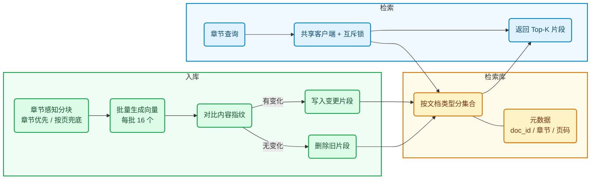

### 9.2 分块规则

- 有章节：以章节为单位，超长时才在句末标点处切分；
- 无书签：按页拆分全文，跳过目录页与少于 10 字的页码/页脚；
- 每个片段带项目名、章节面包屑、页码提示与内容指纹；
- 片段 id 为 `doc_id:index:04d`。

### 9.3 幂等入库

1. 查询当前文档已有片段；
2. 对比片段 id 与内容指纹；
3. 只对新增或内容变化的片段生成向量；
4. 批量写入；
5. 删除不再存在的旧片段；
6. 返回新增、更新、删除、未变与集合总数。

### 9.4 检索规则

- 每次编写创建一个共享检索器；
- 查询用互斥锁串行化，避免并发创建多个客户端；
- 检索可按 `doc_id` 过滤；
- 默认返回 6 个片段；
- 检索失败返回空列表，不阻断写作。

---

## 10. 投标编写编排组件

### 10.1 状态图编排

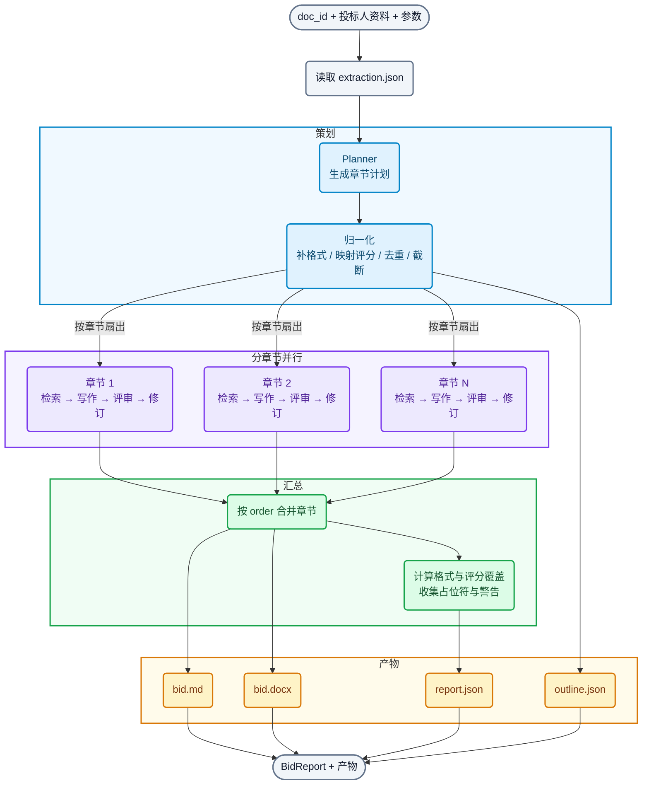

### 10.2 工作机制

1. 读取结构化抽取结果；
2. Planner 生成章节计划；
3. 归一化：
   - 去重；
   - 补缺失的投标文件格式条目；
   - 把评分因素映射到章节；
   - 按章节数量截断；
4. 按章节并行扇出；
5. 每个章节执行完整的写作循环；
6. 汇总章节、生成 Markdown、Word 与覆盖报告；
7. 所有产物写入独立时间戳目录。

### 10.3 章节策略

| 策略 | 行为 |
|---|---|
| `generate` | 检索原文后生成正文 |
| `fill_template` | 按固定格式填写已知信息 |
| `placeholder` | 不调用模型，生成占位模板与 100 分 |

### 10.4 章节数量限制

- 提示词默认建议不超过 25 个章节；
- 接口允许 0–50；
- 截断时优先保留 `generate` 章节；
- 截断后重新排序并重新编号。

---

## 11. 章节编写循环

### 11.1 单章节流程

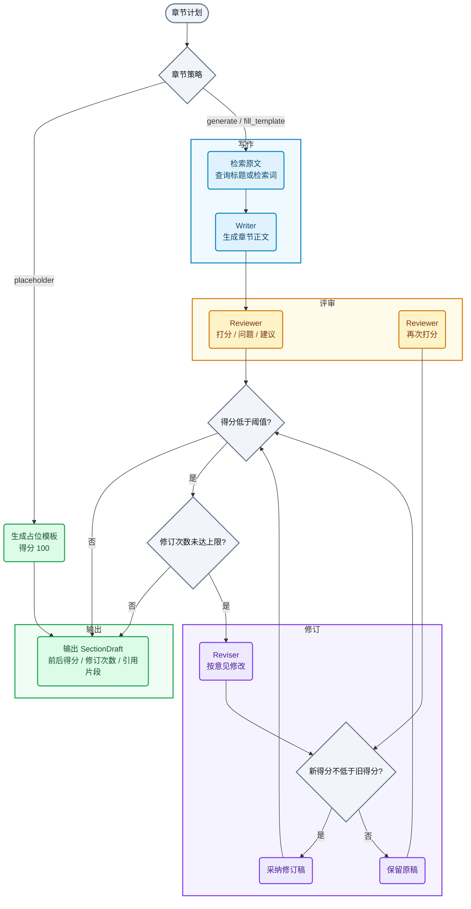

### 11.2 单章节时序

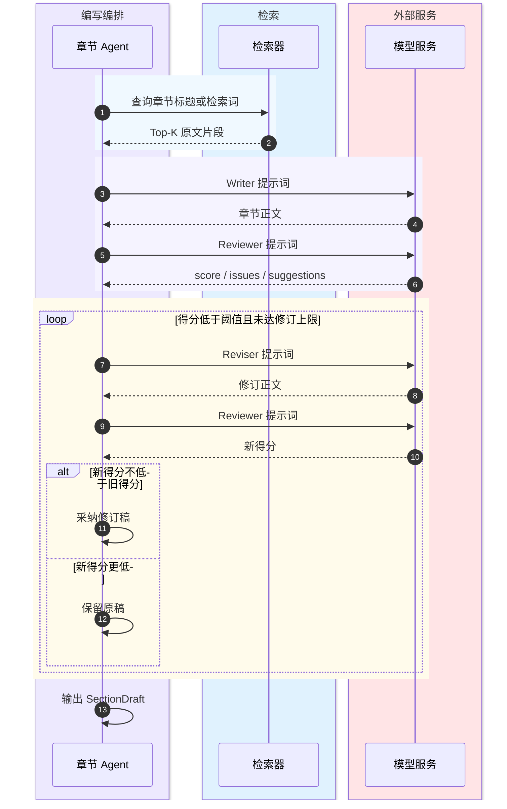

### 11.3 工作机制

- 占位章节不调用模型，直接返回 100 分；
- 检索失败 → 空引用继续；
- 评审失败 → 0 分并记录问题；
- 修订只在“低于阈值且未达次数上限”时进行；
- 每次修订都重新评审；
- 只有新得分不低于当前最佳时才采纳；
- `revisions` 记录尝试次数，不是采纳次数。

---

## 12. 文档库、历史与产物服务

### 12.1 列表、预览与下载

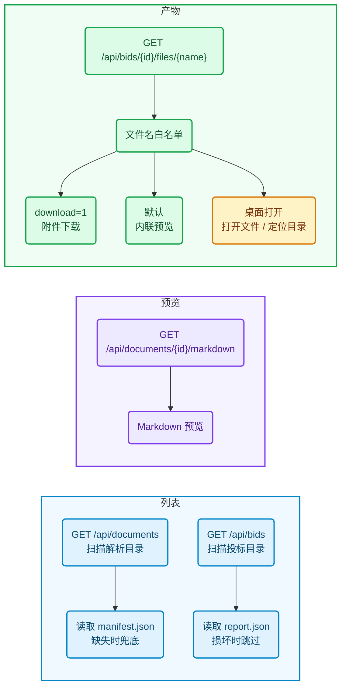

### 12.2 产物下载时序

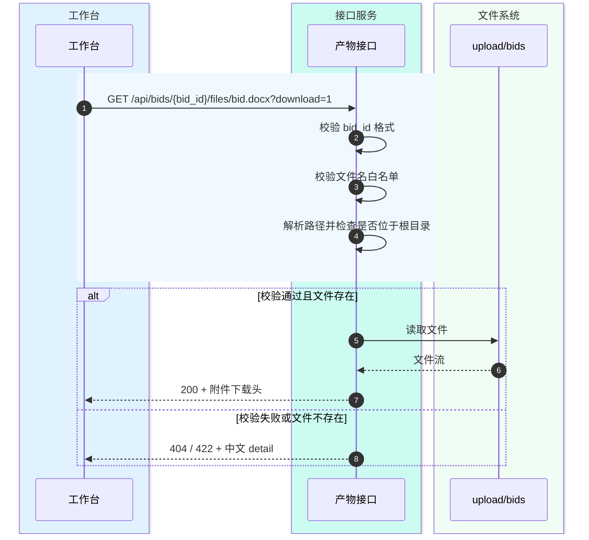

### 12.3 工作机制

- 文档库扫描 `upload/parsed/` 一级目录，按修改时间倒序，最多 200 条；
- 标书历史扫描 `upload/bids/` 一级目录，读取 `report.json`，损坏则跳过，最多 100 条；
- Markdown 预览返回 `content.md`，inline 展示；
- 产物下载只允许 `bid.md`、`bid.docx`、`report.json`、`outline.json`；
- 路径必须位于对应产物目录内，非法标识返回 422，文件缺失返回 404；
- 桌面模式可进一步调用系统打开能力，浏览器模式仅保留预览与下载。

---

## 13. 桌面桥与 IPC

### 13.1 打开文件与定位目录

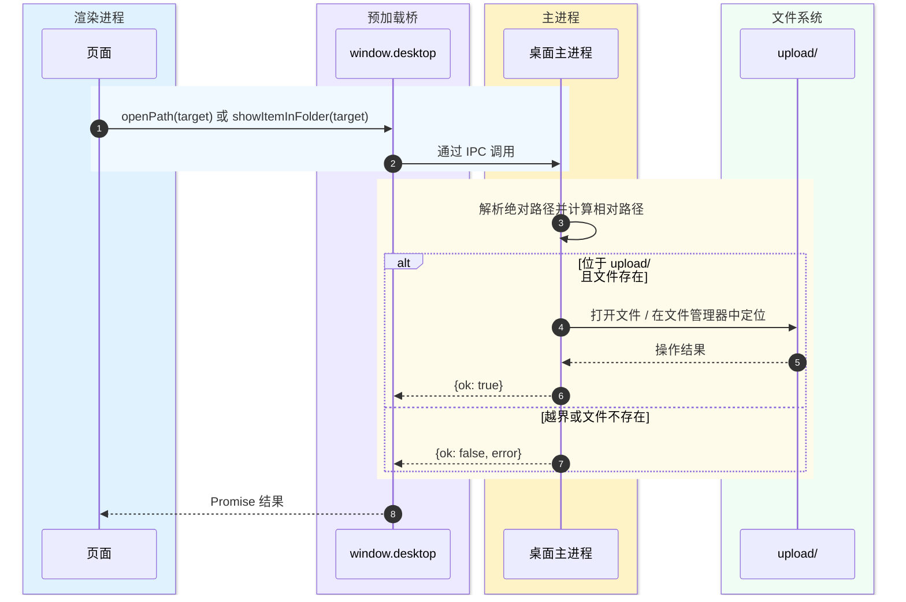

### 13.2 工作机制

- 页面只能通过预加载桥调用两个受限能力：
  - `openPath`：用系统默认程序打开文件；
  - `showItemInFolder`：在文件管理器中定位文件；
- 主进程先解析绝对路径，再判断是否位于白名单根目录；
- 白名单默认是仓库 `upload/`，可用环境变量覆盖；
- 越界、跨盘符、文件不存在都返回失败结果；
- 页面无法直接获得 Node 能力或通用文件系统 API；
- 浏览器环境不显示桌面按钮。

---

## 14. 命令行组件

### 14.1 子命令与流水线复用

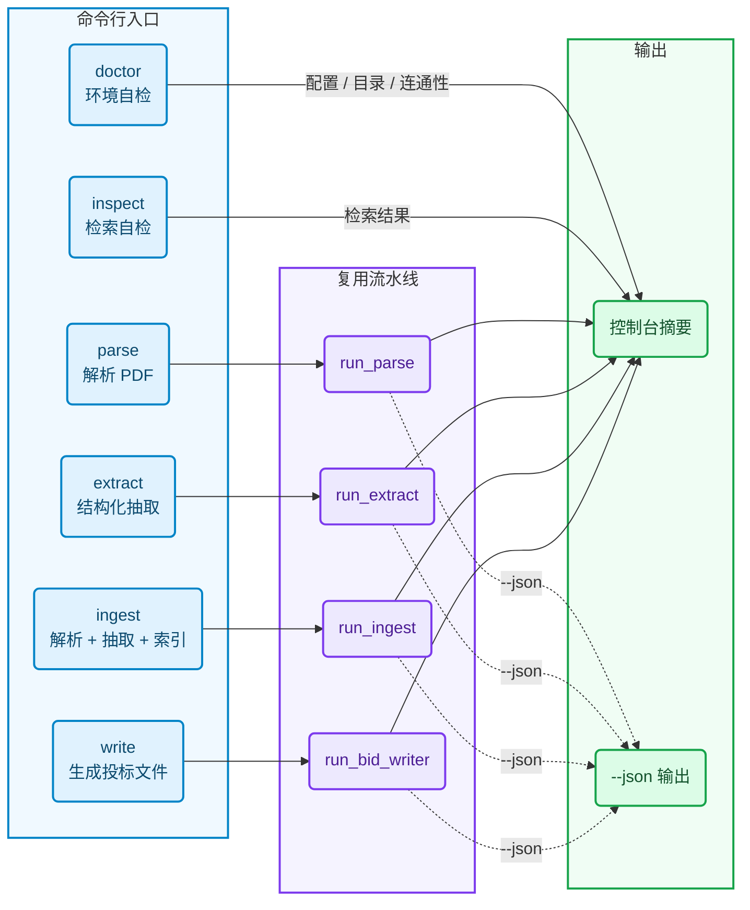

### 14.2 工作机制

- 命令行与接口复用同一套 `run_parse` / `run_extract` / `run_ingest` / `run_bid_writer`；
- `doctor` 检查配置、目录与外部服务；
- `parse` / `extract` / `ingest` 支持 `--force`；
- `inspect` 可列出索引内容或执行查询；
- `write` 支持资料文件、输出目录、修订参数、章节数与 Word 开关；
- `--json` 输出适合脚本消费的摘要。

---

## 15. 配置与健康检查

### 15.1 配置装配

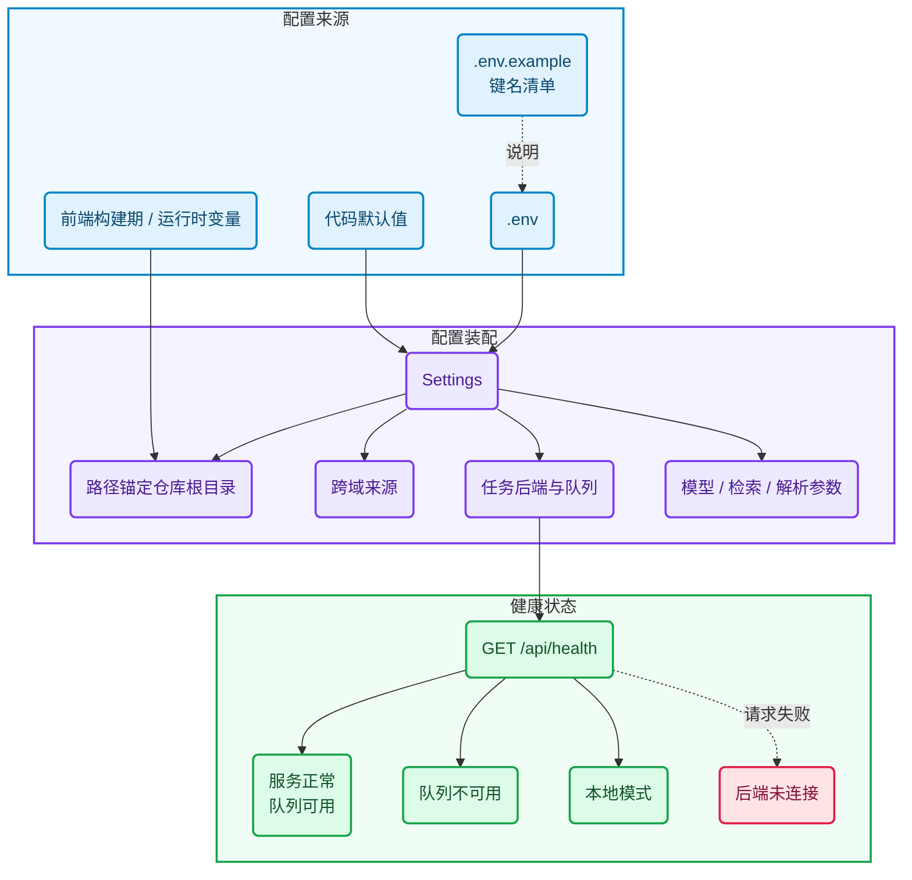

### 15.2 工作机制

- 后端配置从 `.env` 读取，字段名大小写不敏感，额外字段忽略；
- 路径相对仓库根目录解析，不依赖当前工作目录；
- `.env.example` 是键名与默认值的权威清单；
- 前端接口地址在开发态走同源代理，打包后回退到本机地址，可用构建期变量覆盖；
- 健康检查只代表接口与队列状态，不代表执行器已启动；
- 任务是否真正执行，以任务状态为准。

### 15.3 健康状态

| 状态 | 条件 | 前端展示 |
|---|---|---|
| 服务正常 | `broker_ok=true` | 绿色 |
| 队列不可用 | `broker_ok=false` | 红色 |
| 本地模式 | `broker_ok=null` | 灰色 |
| 后端未连接 | 请求失败 | 红色并提示启动命令 |

---

## 16. 存储层

### 16.1 文件、队列与索引

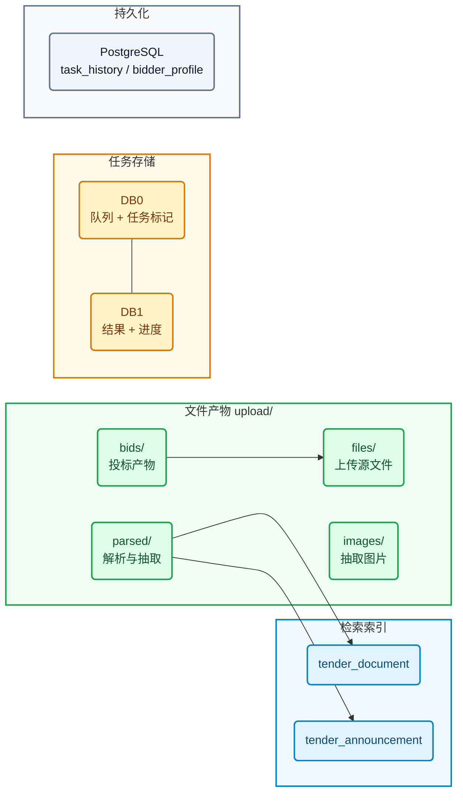

### 16.2 工作机制

- 源文件保存为 `<doc_id>_<安全文件名>.pdf`；
- 解析产物包含 `manifest.json`、`content.md`、`extraction.json`、单元缓存与原始文件；
- 投标产物每次生成独立时间戳目录，不覆盖历史；
- 队列模式使用 DB0 存队列与任务标记，DB1 存结果与进度；
- 检索索引按文档类型分集合；
- PostgreSQL 仅保留配置，当前没有实际读写。

### 16.3 数据保留

| 数据 | 保留 |
|---|---|
| 文件产物 | 持久，需手工清理 |
| 队列结果 | 默认 24 小时 |
| 本地内存任务 | 进程结束即丢失 |
| 检索索引 | 持久，需手工清理 |
| 前端本地记录 | 文档 ID、任务 ID、主题 |

---

## 17. 外部服务

### 17.1 依赖与降级

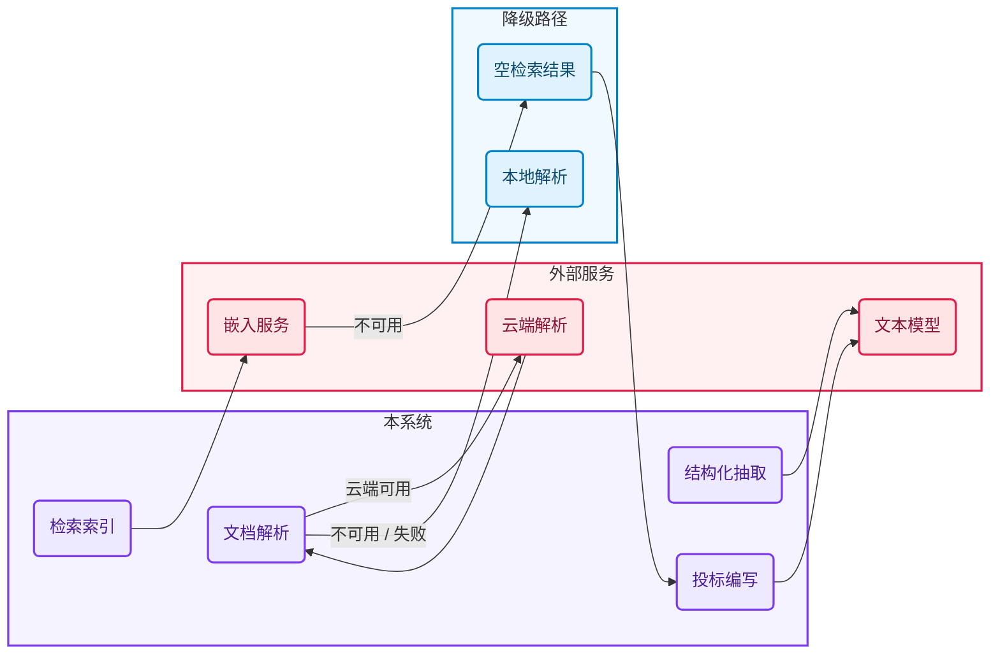

### 17.2 工作机制

| 服务 | 用途 | 失败影响 | 降级 |
|---|---|---|---|
| 云端解析 | 版面、表格、扫描件解析 | 解析质量下降 | 回退本地解析 |
| 文本模型 | 抽取、策划、写作、评审、修订 | 任务失败或章节质量下降 | 无自动替代 |
| 嵌入服务 | 建立索引与检索 | 无法入库或检索为空 | 编写可无检索继续 |

### 17.3 超时与重试

- 云端解析：请求、下载、轮询分别有超时；5xx 与 429 可重试；
- 文本模型：连接、超时、限流、5xx 可重试；4xx 直接失败；
- 嵌入服务：批量调用，失败会使入库或检索初始化失败；
- 所有重试都有次数上限，避免无限等待。

---

## 18. 测试与离线保障

### 18.1 测试守卫与分层

```mermaid
flowchart TB
  subgraph sgGuard["离线守卫"]
    direction TB
    Socket("拦截外部网络<br/>放行回环")
    Tmp("upload / 索引目录<br/>重定向到临时目录")
    Fake("假模型 / 假嵌入<br/>内存索引")
  end

  subgraph sgSuite["测试套件"]
    direction TB
    Suite("离线测试入口")
    Toc("书签 / 归属 / 目录页")
    Parse("分片 / 合并 / 本地解析")
    Extract("单元 / 容错 / 合并 / 缓存")
    Vector("分块 / 幂等入库 / 检索")
    API("上传 / 任务 / 资料库 / 产物")
    Bid("大纲 / 修订 / 覆盖 / Word")
    Suite --> Toc
    Suite --> Parse
    Suite --> Extract
    Suite --> Vector
    Suite --> API
    Suite --> Bid
  end

  subgraph sgBuild["前端门禁"]
    direction TB
    TSC("类型检查")
    Build("生产构建")
    TSC --> Build
  end

  Socket --> Suite
  Tmp --> Suite
  Fake --> Suite
  Suite --> Result("全量测试通过")
  Build --> Result

  classDef guard fill:#ffe4e6,stroke:#e11d48,stroke-width:2px,color:#881337
  classDef suite fill:#e0f2fe,stroke:#0284c7,stroke-width:2px,color:#0c4a6e
  classDef build fill:#fef3c7,stroke:#d97706,stroke-width:2px,color:#78350f
  classDef result fill:#dcfce7,stroke:#16a34a,stroke-width:2px,color:#14532d
  class Socket,Tmp,Fake guard
  class Suite,Toc,Parse,Extract,Vector,API,Bid suite
  class TSC,Build build
  class Result result

  style sgGuard fill:#fff1f2,stroke:#e11d48,stroke-width:2px
  style sgSuite fill:#f0f9ff,stroke:#0284c7,stroke-width:2px
  style sgBuild fill:#fffbeb,stroke:#d97706,stroke-width:2px
```

### 18.2 工作机制

- 任何外部网络连接在测试中直接失败，避免误用真实额度；
- 上传、索引目录重定向到临时目录，不污染仓库；
- 使用合成 PDF、假模型、假嵌入与内存索引；
- 测试覆盖结构、解析、抽取、索引、接口、任务、编写、导出；
- 前端没有自动化交互测试，质量门禁为类型检查与生产构建。

---

## 19. 端到端时序

### 19.1 从上传到产物下载

```mermaid
sequenceDiagram
  autonumber
  box rgb(224, 242, 254) 桌面工作台
    participant UI as 工作台
  end
  box rgb(204, 251, 241) 接口服务
    participant API as 接口服务
  end
  box rgb(254, 243, 199) 任务层
    participant Q as 任务队列
    participant W as 后台执行器
  end
  box rgb(237, 233, 254) 处理引擎
    participant P as 解析 / 抽取 / 索引
    participant B as 编写编排
  end
  box rgb(255, 228, 230) 外部服务
    participant X as 模型 / 嵌入 / 云端
  end

  rect rgb(240, 249, 255)
    Note over UI,API: 1. 文档接入
    UI->>API: 上传 PDF（extract + ingest）
    API->>Q: 创建解析任务
    API-->>UI: 202 + job_id + doc_id
  end

  rect rgb(255, 251, 235)
    Note over Q,P: 2. 解析、抽取、索引
    Q->>W: 消费解析任务
    W->>P: 解析 → 抽取 → 建立索引
    P->>X: 云端解析 / 文本模型 / 嵌入
    X-->>P: 结果
    P-->>W: 摘要
    W-->>Q: 结果与进度
  end

  rect rgb(240, 253, 244)
    Note over UI,API: 3. 轮询解析任务
    loop 每秒，直到终态
      UI->>API: 查询任务
      API-->>UI: 状态 / 进度
    end
  end

  rect rgb(245, 243, 255)
    Note over UI,B: 4. 编写投标文件
    UI->>API: 创建编写任务（doc_id + 资料）
    API->>Q: 入队
    Q->>W: 消费编写任务
    W->>B: 策划 → 分章节 → 汇总
    B->>X: 检索 + 写作 + 评审 + 修订
    X-->>B: 章节与评分
    B-->>W: bid.md / docx / report.json
    W-->>Q: 结果
  end

  rect rgb(255, 241, 242)
    Note over UI,API: 5. 查看与交付
    UI->>API: 预览 / 下载产物
    API-->>UI: Markdown / Word / 报告
  end
```

### 19.2 端到端检查点

| 阶段 | 成功标志 | 失败表现 |
|---|---|---|
| 上传 | 202 + `job_id` + `doc_id` | 400 / 413 / 422 / 429 / 503 |
| 解析 | `status=succeeded`，`result` 有值 | `failed` + `error_type` |
| 抽取 | `extraction` 有值 | `extraction=null` 或任务失败 |
| 索引 | `ingest.total` 增加 | 任务失败或无正文 |
| 编写 | `bid` 有值，产物目录存在 | `failed` + `error` |
| 下载 | 200 + 正确文件类型 | 404 / 422 |
| 桌面打开 | `{ok:true}` | `{ok:false,error}` |

---

## 20. 组件与代码映射

| 组件 | 主要代码 | 职责 |
|---|---|---|
| 桌面工作台 | `frontend/src/App.tsx`、`frontend/src/features/` | 四个工作区、共享状态、轮询、表单、结果展示 |
| 接口服务 | `api/routes.py`、`api/library.py`、`api/schemas.py` | 上传、编写、轮询、资料库、产物 |
| 任务分发 | `api/dispatch.py`、`api/jobs.py` | 队列/本地后端、任务状态、结果映射 |
| 后台执行器 | `src/tasks.py`、`src/celery_app.py` | 任务定义、进度、解析/编写执行 |
| 文档解析 | `src/parsing/` | 书签、分片、云端/本地解析、合并、产物 |
| 结构化抽取 | `src/extraction/` | 单元切分、提示词、Schema、合并、核对、缓存 |
| 检索索引 | `src/vectorstore/` | 分块、嵌入、幂等入库、检索 |
| 编写编排 | `src/bid_writer/graph.py`、`agents.py` | 策划、扇出、写作、评审、修订、汇总 |
| 覆盖报告 | `src/bid_writer/assembly.py`、`src/summaries.py` | 格式/评分覆盖、占位符、摘要 |
| Word 导出 | `src/bid_writer/docx_export.py` | Markdown 转 Word |
| 桌面桥 | `frontend/electron/main.cjs`、`preload.cjs` | IPC、路径白名单、打开文件/定位 |
| 命令行 | `src/cli/` | 解析、抽取、索引、检索、编写、自检 |
| 配置 | `src/config.py`、`.env.example` | 环境配置、路径、参数 |
| 测试 | `tests/` | 离线测试、守卫、夹具 |

---

## 21. 图形维护约定

1. 新增组件时，优先新增**独立子图**，并使用本文档的颜色图例；
2. 动作节点统一使用圆角矩形 `id("...")`；
3. 子图必须使用显式 ID，才能用 `style` 着色；
4. 判断节点只在真正分支时使用菱形，避免图形过度复杂；
5. 时序图用 `box` 区分参与方，用 `rect` 区分阶段；
6. 同一张图内颜色不超过 6 种，避免视觉噪声；
7. 标签避免出现未转义的 `<`、`>`，防止被当作 HTML 标签；
8. 新增外部依赖或降级路径时，同步更新“外部服务”与“端到端时序”。

---

*文档结束。*
